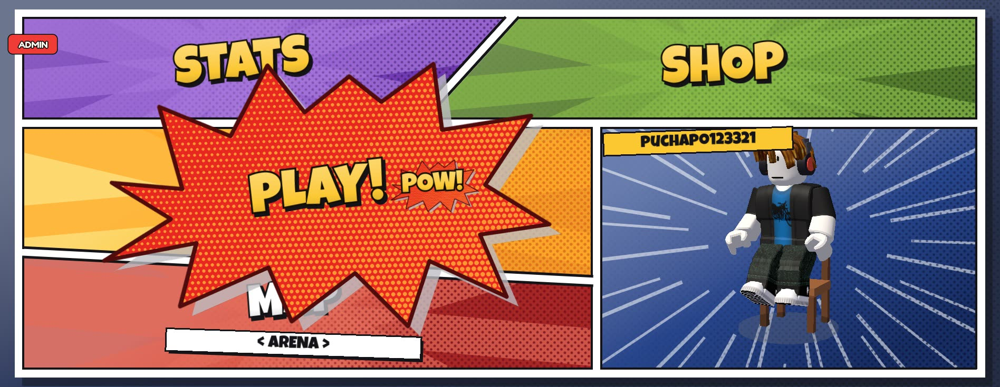
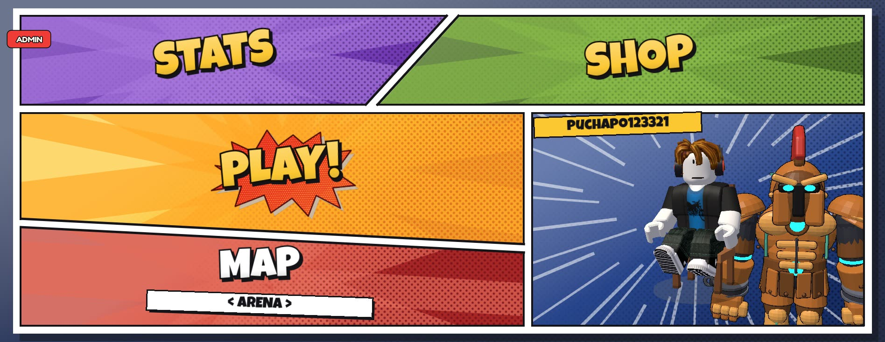
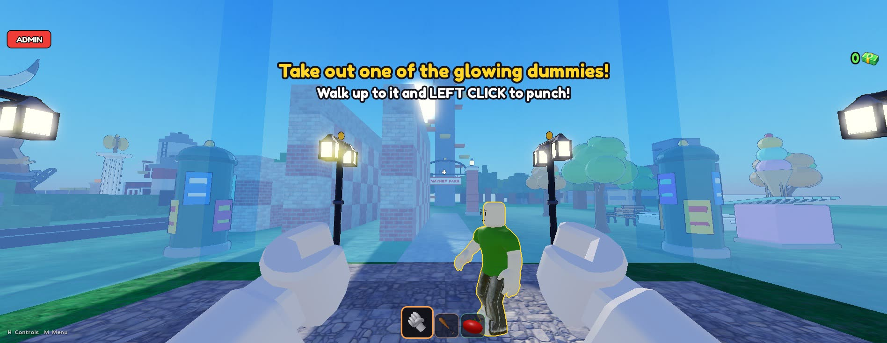
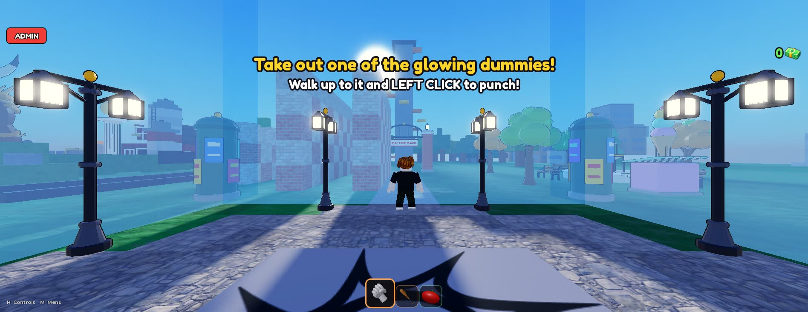
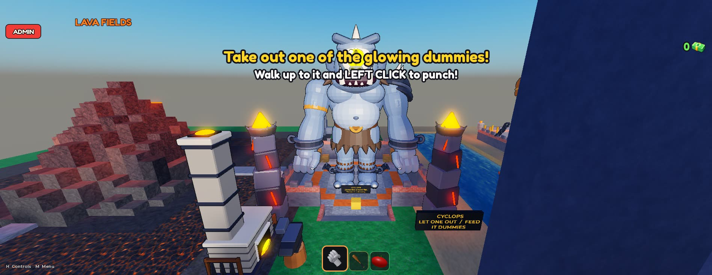
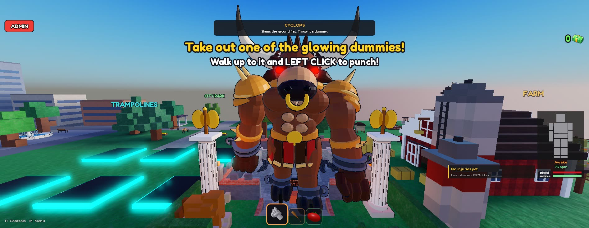
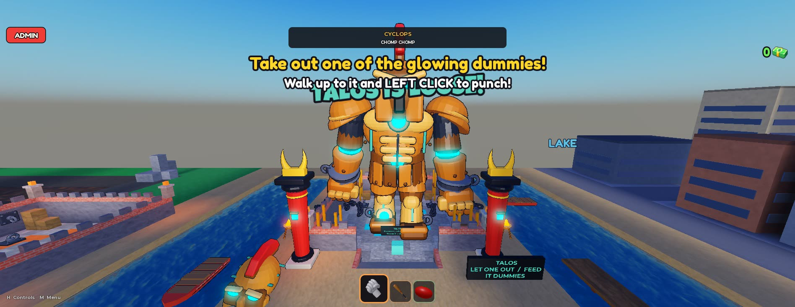

# Audyt pierwszych 5 minut (26.11.2026)

Gałąź `update/first-five-minutes`. Badania: [research/pierwsze-5-minut.md](research/pierwsze-5-minut.md).
Audyt zrobiony w Studio Play jako nowy gracz (Studio nie czyta DataStore, więc każdy start = pierwszy raz),
sterowanie przez Studio MCP, czasy z sondy po stronie klienta. Oceny 1–10 są moje, nie z danych graczy:
analityka FirstSession (niżej) jest po to, żeby je zastąpić prawdziwymi liczbami po publikacji.

## Oś czasu: jak było

| Moment | Co widzi nowy gracz | Problem |
|---|---|---|
| 0–2 s | Komiksowe menu (STATS / SHOP / MAP / PLAY), awatar na krześle | 2D, brak bossa w tle; PLAY wciska się sam po wczytaniu zapisu |
| 2–5 s | Awatar zeskakuje, odwraca się, odchodzi; niebieski flood | 3,2 s animacji, **nie da się pominąć** |
| ~5 s | Szklana klatka, manekin w żółtej obwódce, „Take out one of the glowing dummies!” | Linijka „Click: punch” leciała **pod menu** (2 s, nikt jej nie widział) |
| 5–15 s | 6 klawiszy na dole (V, E, Q, F, TAB, CTRL) + „H Controls M Menu” | Za dużo naraz; nic nie mówi „kliknij, żeby uderzyć” |
| pierwszy cios | BAM, wstrząs, podpowiedź „F grab” | OK |
| pierwszy KO | banknoty lecą do licznika, krok „Press Q: buy the HANDGUN” | OK, ale brak mocniejszego momentu nagrody |
| koniec tutorialu | „TUTORIAL COMPLETE! Have fun.”, klatka pęka, cel „NEXT: …” | OK; brak zachęty do bossów |
| 2–5 min | wolna zabawa, bossy w dołach (trzeba je znaleźć samemu) | Brak wydarzenia / wskazówki do bossów |

Dodatkowo: brak ustawień wstrząsu ekranu i błysków; `Fx.shake` bez limitu (bomba: 3 studs na 3 s +
~15° FOV); impact frames snajpera to pełnoekranowe czarno-białe miganie; brak pomiaru czasu do
pierwszego ciosu i KO (lejek Onboarding miał 4 kroki, wszystkie 10 lejków zajęte).

## Oceny (przed → po tym etapie)

| Obszar | Przed | Po | Co zmieniło ocenę |
|---|---|---|---|
| Menu: pierwsze wrażenie | 6 | 7 | losowy boss (Cyklop / Minotaur / Talos) w 3D za krzesłem, ryczy co 9 s |
| PLAY → gra | 5 | 8 | pomijanie: klik / tap / Spacja / Enter / A po 0,5 s, napis „CLICK OR SPACE TO SKIP” |
| Czytelność pierwszego celu | 6 | 8 | 0 klawiszy w kroku „kill”, tylko Q w kroku „pick”; linijka sterowania pięści po zniknięciu menu (4 s) |
| Pierwszy cios | 6 | 8 | „Walk up to it and LEFT CLICK to punch!” po 6 s, tylko gdy jeszcze nie uderzył |
| Pierwszy KO / nagroda | 7 | 7 | bez zmian (banknoty działały) |
| Bossy (2–5 min) | 5 | 8 | +20% skali, ryk przy wypuszczeniu, szarpanie łańcuchów, kołysanie, wstrząs przy trafieniu, baner „X IS LOOSE!”, podpowiedź do dołu po 75 s od końca tutorialu |
| Komfort (wstrząsy, błyski) | 3 | 8 | suwak SCREEN SHAKE, przełącznik FLASHES, Reduce Motion, limit 1,2 studs |
| Mierzalność | 4 | 8 | FirstSession (sekundy od wejścia) + Onboarding kroki 5–6 |

## Analityka

Nie zajmuję nowego lejka (limit 10). Zamiast tego:
- **Onboarding** (liniowy, kroki tylko dopisane): Joined → Entered arena → First kill → Took pistol →
  **KO after tutorial** → **Bought 2nd weapon**. Kroki 5–6 tylko u graczy, którzy zrobili tutorial po tej zmianie.
- **FirstSession** (custom event, wartość = sekundy od wejścia, raz na gracza, tylko pierwsza sesja):
  MenuLoaded, PlayClicked, IntroCompleted / IntroSkipped, FirstMove, FirstWeaponUsed, FirstHit, FirstKO,
  FirstReward, TutorialCompleted, FirstUnlock, opcjonalne BossEncountered, BossHit, oraz Session60/180/300.
  Klient może zgłosić tylko 5 nazw z białej listy; czas liczy serwer. BossDefeated nie istnieje:
  bossów nie da się pokonać (tak jest zaprojektowana gra).

Sprawdzone w Studio Play (wydruki zamiast wysyłki): Joined, MenuLoaded, PlayClicked, Entered arena,
IntroCompleted, IntroSkipped, FirstHit, FirstKO, FirstReward, First kill, Took pistol, TutorialCompleted,
Session60/180/300. Czasy z testu MCP nie są realne (klikanie przez MCP trwa sekundy na akcję).

## Czego nie zrobiłem (uczciwie)

- **Modele bossów w Blenderze** (oczy, zęby, asymetria) i **klatki kluczowe animacji**: zmiana siatki wymaga
  ponownego uploadu MeshPartów (klucz API albo Import 3D w Studio). Animacje bossów są proceduralne
  (`MythRig.pose`): Idle, Walk, Roar, Windup/Strike/Recovery, Charge, Eat, Caged, drgnięcie przy trafieniu.
- **Kinematyka PLAY z Blendera**: obecne wyjście z menu (awatar zeskakuje i odchodzi, 3,2 s) da się pominąć po 0,5 s,
  więc osobny film tylko by je wydłużył.
- **Hitstop** (35–80 ms po stronie klienta): nie ruszałem, bo trafienia już mają impact frames i wstrząs.
- **Testy na prawdziwym telefonie**: nie robiłem. Interfejs używa Scale, a pigułka „TAP TO SKIP” zmienia tekst na dotyku.

## Etap 2: przegląd po zmianach (26.11.2026)

Ten sam sposób: Studio Play, sterowanie przez MCP, nowy gracz przy każdym starcie. Czasy z konsoli (FirstSession) pochodzą
z testów MCP i **nie są czasami prawdziwych graczy**. Prawdziwe liczby pokaże dopiero analityka po publikacji.

### Oś czasu: jak jest teraz

| Moment | Co się dzieje | Źródło |
|---|---|---|
| menu | Boss w całości w swoim kadrze za awatarem (koncepcja B „Plakat”). Nic nie odlicza czasu, nic się nie wciska samo. | `docs/menu-concepts.md` |
| PLAY | Animacja z Blendera, 4,67 s: reakcja, wstanie, zdjęcie słuchawek, odwrócenie, marsz, kamera wjeżdża w głowę, cięcie do FPP. Pomijanie po 0,5 s. | `docs/play-intro.md` |
| pierwszy cel | Klatka, jeden manekin w żółtej obwódce. Linijki „Take out one of the glowing dummies!” i „Walk up to it and LEFT CLICK to punch!”. | test Studio |
| pierwsze ciosy | Hitstop tylko u gracza, kick kamery, pierścień wokół celu, licznik combo nad ofiarą (x2…x6), dymki komiksowe | `docs/game-feel/combo_ko_studio.mp4` |
| pierwszy KO | Klatka uderzenia w stylu mangi (żółto-czarna), naklejka KO, „+$15”, banknoty lecą do licznika (0 → 15), od razu krok „Press Q: buy the HANDGUN” | to samo nagranie |
| 1–5 min | Bossy w dołach, podpowiedź do dołu po 75 s od końca samouczka. Nowym graczom nie trafiają katastrofy (`server/Disasters`, `isNew`). | kod |

W samouczku manekin padł po 6 ciosach (ciosy liczą się tam podwójnie). Przy tempie klikania przez MCP to około 3 s od pierwszego trafienia.

### Presja: czego szukałem i co jest

Sprawdziłem w kodzie wszystko, co mogłoby przyspieszać gracza albo naciskać na zakup w pierwszych 5 minutach:

- **Liczniki czasu i FOMO:** brak. Jedyne odliczanie to banner katastrofy, a katastrofy omijają nowych graczy. Nie ma ofert czasowych, dziennych nagród ani serii logowań.
- **Zakupy:**
  - Robux pojawia się tylko po akcji gracza. Wybór broni, na którą go nie stać, najpierw pokazuje „cash / price$ · PICK AGAIN FOR CASH”, a pakiet gotówki otwiera się dopiero przy drugim wyborze w ciągu 4 s.
  - Passy w SHOP i Toolboksie otwierają się po kliknięciu zablokowanej rzeczy.
  - Nic nie wyskakuje samo.
- **Losowe płatne nagrody:** brak.
- **Prośby (`client/LikePrompt`):**
  - „Like” dopiero po 10 min gry.
  - „Favorite” po 3 min gry albo po kupnie drugiej broni.
  - „Group” po 7 min albo po trzeciej broni.
  - Wszystkie czekają na koniec samouczka i nic za nie nie daje (poza Frost Gunem za grupę, co jest zgodne z zasadami Roblox).
- **Combo i KO:**
  - Licznik combo gaśnie po 1,4 s bez ciosu. Nic nie przepada i nie ma kary za przerwanie.
  - „KO xN!” to tylko napis.

**Do rozważenia (nie zmieniałem, bo to decyzja produktowa):** natywne okno „Favorite” w 3. minucie może wypaść w środku walki w FPP. Bezpieczniej byłoby pokazać je w spokojnym momencie, np. po zamknięciu Arsenału albo po kilku sekundach bez ciosu. Nie mam danych, czy to zmniejszy liczbę dodań do ulubionych.

### Co poprawiłem w tym etapie po teście

- **Pierścień i błysk ciosu z bliska** (`Fx.radial`, `Fx.hit`): przy ciosie z ~3 studów w FPP zasłaniały połowę ekranu i cel. Teraz skalują się odległością (`docs/game-feel/ring_before_after.jpg`). Z daleka wyglądają jak wcześniej.

### Oceny (po etapie 1 → po etapie 2)

Moje oceny, nie dane graczy.

| Obszar | Po etapie 1 | Po etapie 2 | Dlaczego |
|---|---|---|---|
| Menu: pierwsze wrażenie | 7 | 8 | Boss w całości i nie zasłania awatara. Trzy koncepcje, wybrana B. |
| PLAY → gra | 8 | 8 | Animacja dużo bardziej „filmowa”, ale dłuższa (4,67 s zamiast 3,2 s). Pomijanie bez zmian. |
| Pierwszy cios | 8 | 9 | Hitstop, kick i combo. Cel widać mimo efektów. |
| Pierwszy KO / nagroda | 7 | 9 | Klatka uderzenia, naklejka KO, „+$15” i dźwięk kasy. |
| Bossy (wygląd) | 8 | 8 | Modele v4 i 12 klipów na bossa są gotowe, ale **w grze nadal kit v1**, dopóki nie zrobisz importu (`docs/import-bossow-v4.md`). |
| Komfort | 8 | 8 | Nowe efekty respektują SCREEN SHAKE, FLASHES i Reduce Motion. |

### Czego nie sprawdziłem

- Prawdziwego telefonu.
- Emulatora urządzeń Studio (nie da się go przełączyć przez MCP).
- Czasów prawdziwych graczy.
- Dźwięku: nagrania MCP nie mają ścieżki audio, więc zróżnicowanie dźwięków ciosów sprawdziłem tylko w kodzie (`Sfx.playLocal`, wysokość ±10% i warianty).

## Zrzuty (Studio Play, 26.11.2026)

| Przed | Po |
|---|---|
|  |  |
| |  |
| |  |
| |  |
| |  |
| |  |
