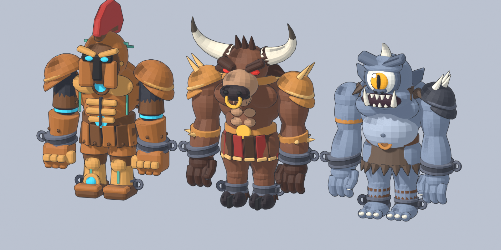
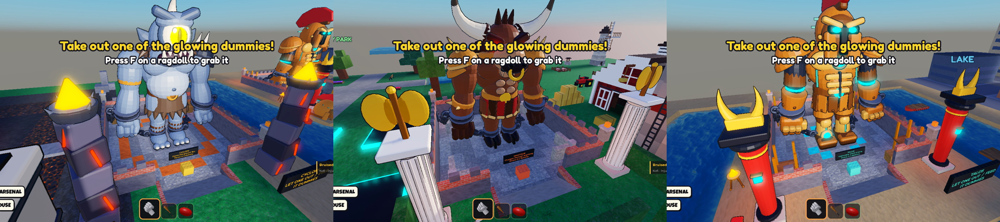

# Mapa Arena 2.0 — Mayhem Park

Stan na 26.11.2026.

## Założenia

- Arena (środek, ±80 studs) to park miejski: plac z pomnikiem, miasteczko, park z fontanną, kręgielnia i budowa.
- Każdy boss ma własne legowisko w dzielnicy, do której pasuje:
  - Cyklop w kuźni pod wulkanem.
  - Minotaur za labiryntem z żywopłotu.
  - Talos na wyspie na jeziorze.
- Rekwizyty to modele z Blendera, które zachowują się jak dotąd (szkielety w `KINDS` i `SKINS`, opis w `Map.luau`):
  - Cały obiekt stoi jako siatka.
  - Pierwsze trafienie zamienia go w kostki w kolorach modelu.
  - Kostki się rozsypują, a potem obiekt odbudowuje się w całości.
- Bez zaimportowanego kitu nic się nie psuje. Każdy rodzaj ma zapasowy kształt z klocków, a lochy mają czerwone łuki jak wcześniej.


Fioletowy kolor na domach i dębach to kolor zastępczy (`FE01FE`). W grze każdy rodzaj maluje go po swojemu:
- `HouseA` na żółto, `HouseB` na niebiesko, `HouseC` na różowo, `Shop` na kremowo.
- `OakA` i `OakB` na zielono (dwa odcienie), `OakC` na jesienny pomarańcz.

## Układ

| Strefa | Gdzie (x, z) | Co stoi |
| --- | --- | --- |
| Plac | środek | 8 latarni w kręgu, pomnik bohatera na (0, −40) przodem do spawnu, 4 słupy ogłoszeniowe na (±24, ±24) jako osłona |
| Bramy parku | (0, ±72), (±72, 0) | ceglane bramy „MAYHEM PARK” na czterech ścieżkach |
| Miasteczko (NE) | x 29..75, z −73..−27 | trzy domy i kawiarnia przy uliczce x = 52; blok mieszkalny (ruch po dachach) przesunięty na (18, −64), poza bramę |
| Park (NW) | wokół (−48, −48) | fontanna, 3 ławki, 5 dębów i sosna, budka z lodami |
| Kręgielnia (SW) | jak wcześniej | tor, ściana, skała, dąb |
| Budowa (SE) | wokół (50, 50) | 2 rusztowania, żuraw wieżowy, betoniarka, skrzynie, wieża, skała |

### Legowiska bossów (`Map.LAIRS`)

Każde legowisko to ramka: środek dołu na ziemi, obrócony tak, że rampa wychodzi w stronę areny (oś +z legowiska). Dół, mury z blankami, rampa i pochodnie są takie jak wcześniej, tylko obrócone razem z ramką. Klatek już nie ma: boss stoi przykuty łańcuchami na dnie dołu (sekcja „Bossowie”).

| Boss | Środek dołu | Wyjście | Pylony i otoczenie |
| --- | --- | --- | --- |
| Cyklop | (176, −96) | na zachód, w stronę kanionu | 2 bazaltowe pylony z lawą i ogniem, kuźnia z kominem, kowadło. Most nad lawą kończy się 6 studs przed murem |
| Minotaur | (−61, 140) | na północ, przez labirynt | 2 marmurowe kolumny ze złotym labrysem, posąg byka w ślepym rogu przy dole |
| Talos | (200, 0) | na zachód, groblą do brzegu | 2 czerwone kolumny minojskie ze złotymi rogami, 2 kosze ognia po bokach dołu, wielka brązowa głowa wbita w piasek |

Pylony stoją po obu stronach wyjścia (x ±21,5, z 26 w ramce; u Talosa z 25,5), na tyle szeroko, że 36-studsowy boss przechodzi między nimi z machającymi rękami. Bramy z ArenaKit (`ForgeGate`, `BullGate`, `TalosGate`) i kolumny `MinoanColumn` nie stoją już przy legowiskach: były niższe od bossów.

Tablica z imieniem bossa i „LET ONE OUT / FEED IT DUMMIES” stoi przy wejściu do każdego legowiska. Zastępuje dawną wspólną tablicę MYTH YARD.

**Zmiany w terenie**
- Wyspa na jeziorze urosła do x 160..240, z −32..32 (drzewa z niej zniknęły).
- Od zachodniego brzegu prowadzi brukowana grobla: x 144..160, z −16..16.
- Kanion parkour ma przerwę na z −20..20, czyli prostą drogę z areny na groblę. Napis kanionu przeniesiony na z −48.
- Napis LAKE przeniesiony na (196, 50).

**Labirynt (żywopłoty 6 studs)**
- Wejście od północy, między x −70 a −62.
- Dwa rzędy w serpentynę z dwoma ślepymi zaułkami, a na końcu brama Minotaura.
- Ściany tylko stykają się końcami, nigdy nie nachodzą (ZFight 0).
- Boss wychodzący z legowiska przebija się przez żywopłot, a ten odrasta.

## Bossowie (26.11.2026)



- Trzy nowe modele z Blendera (`assets/myth/build_bosses.py`): Cyklop, Minotaur i Talos. Styl kreskówkowy, ale groźny, z czarnymi konturami jak reszta gry (odwrócona powłoka, jak w ArenaKit).
- Bossowie są 3 razy więksi niż wcześniej: Cyklop `scale` 3, Minotaur 2,8, Talos 3,1, czyli około 36 studs wzrostu (gracz ma 5). Szybkość, promień ciosu, zasięg ataku (`reach`) i miejsce uderzenia (`lunge`) są w `Mythology.luau`.
- Każdy boss stoi na środku dna swojego dołu, przodem do rampy, cały widoczny. Trzymają go 4 łańcuchy: z kajdan na nadgarstkach do płyt na bocznych ścianach dołu i z kajdan na kostkach do pierścieni w podłodze.
- Przycisk (Y) u stóp rampy zrywa łańcuchy (ogniwa odpadają i znikają po 4 s) i boss wychodzi rampą między pylonami. Ponowne wciśnięcie odsyła go na dno dołu i zakuwa na nowo.
- Boss sprawdza drogę bryłą od wysokości kolan do ramion. Żywopłot czy mur go zatrzyma (i rozbije, jeśli to element mapy), a rampa czy krawężnik już nie. Pylony go nie blokują, ale gracze się o nie opierają.
- Bez `MythKit` wszystko działa na zapasowych kształtach: bossowie z klocków, łańcuchy z bloczków, pylony jako kamienne słupy z ogniem.

**Pipeline bossów**

```powershell
& "C:\Program Files\Blender Foundation\Blender 5.2\blender.exe" -b --factory-startup -P assets/myth/build_bosses.py
& "C:\Program Files\Blender Foundation\Blender 5.2\blender.exe" -b assets/myth/bosses.blend -P assets/myth/export_bosses.py
python assets/myth/gen_install.py
```

1. `build_bosses.py` modeluje 3 bossów (po 15 części ciała w przestrzeni rigu `MythRig`), ogniwo łańcucha, płytę kotwicy i 3 pylony, po czym zapisuje `bosses.blend`. Bez `-b` (np. z Blender MCP) buduje to samo w scenie `MythBosses` otwartego pliku.
2. `export_bosses.py` zapisuje `MythKit.glb` (243 siatki, 164 tys. trójkątów, 8,9 MB, maks. 10 tys. na część) i `manifest.json`.
3. `gen_install.py` generuje `install.luau`. Uruchamia się go raz w Studio, w trybie edycji, po wgraniu `MythKit.glb` (`MODEL_ID` z `ids.json` albo model z File > Import 3D). Siatki trafiają do `ReplicatedStorage.MythKit/<Boss>/Boss|Lair` i `MythKit/Chain/Parts`. Na końcu trzeba zapisać place.

Stary pipeline klatek (`blender/build_myth_yard.py`, `export_myth_kit.py`, trzy pliki `MythKit_<Boss>.glb`) jest usunięty.

**Sprawdzone w Studio z kitem (26.11.2026)**



- `MythKit.glb` wgrany przez Open Cloud na grupę 1109456163 jako model `116507146031319` i zatwierdzony przez moderację (`ids.json`).
- `install.luau` przeniósł 243 z 243 siatek do `ReplicatedStorage.MythKit`, każda ma MeshId i `Place`. Place zapisany (Team Create, wersja 678), nie opublikowany.
- W trybie Play bossowie mają 65 (Cyklop), 72 (Minotaur) i 79 (Talos) siatek oraz około 34–38 studs wzrostu i stoją stopami na dnie dołu.
  - Naprawiony błąd: `Rig.pose` brał spoczynkowe C0 zapisane przed `ScaleTo`, więc przy skali 3 kończyny ściągały się do tułowia, a stopy wisiały 4 studs nad ziemią. `Rig.build` zapisuje teraz `RigRestC0` po przeskalowaniu.
- Każdy boss ma 26–28 ogniw łańcuchów. Wypuszczenie zrywa wszystkie (spadają i znikają), boss wychodzi rampą i w kilka sekund jest na arenie przy manekinach. Odwołanie stawia go na dnie i zakuwa na nowo.
- Pylony nie nachodzą na nic z mapy. ZFight wynosi 0 dla lochów, klatek, tablic i labiryntu (`HedgeMaze`).
- Wypuszczenie i odwołanie sprawdził hook dostępny tylko w Studio: `ServerStorage.MythTest:Invoke(kind, "release" | "recall")`, który wywołuje te same funkcje co przycisk. Promptu nie da się wyzwolić w sesji Play sterowanej przez MCP (nie pokazuje się, a `InputHoldBegin` i klawisz Y nic nie robią), więc samego przycisku trzeba spróbować ręcznie.

## Pipeline z Blendera

```powershell
& "C:\Program Files\Blender Foundation\Blender 5.2\blender.exe" -b --factory-startup -P assets/arena/build.py
& "C:\Program Files\Blender Foundation\Blender 5.2\blender.exe" -b assets/arena/arena.blend -P assets/arena/export.py
& "C:\Program Files\Blender Foundation\Blender 5.2\blender.exe" -b assets/arena/arena.blend -P assets/arena/voxels.py
python assets/arena/gen_install.py
```

Skrypty po kolei:

1. `build.py` modeluje 22 elementy w przestrzeni Robloxa (studs, przód −Z) i zapisuje `arena.blend`.
2. `export.py` zapisuje `ArenaKit.glb` (211 siatek, 144 tys. trójkątów, 7,6 MB, maks. 19 tys. na siatkę) i `manifest.json`.
3. `voxels.py` generuje `src/server/ArenaVoxels.luau`. Na każdy element przypadają kostki do rozpadu (5124 w sumie, żadnej luźnej) i bloki kolizji (najwyżej 48).
4. `gen_install.py` generuje `install.luau` z manifestu.
5. `render.py` robi podglądy: `blender -b assets/arena/arena.blend -P assets/arena/render.py -- OUT_DIR`.

**Wdrożenie do Studio (raz)**

1. W Studio otwórz File > Import 3D, wskaż `assets/arena/ArenaKit.glb` i zaimportuj do Workspace jako jeden model (Studio nazywa go `Scene`, skrypt przyjmie też `ArenaKit`).
2. W trybie edycji uruchom `assets/arena/install.luau`. Przenosi siatki do `ReplicatedStorage.ArenaKit` i nadaje im atrybut `Place`.
3. Zapisz place.

Od tej chwili `Map` buduje rekwizyty z siatek, a `Monsters` stawia bramy i otoczenie legowisk.

## Sprawdzone (Studio, tryb Play, bez kitu)

- Luau kompiluje się bez nowych ostrzeżeń, a `rojo build` przechodzi.
- Wszystkie trzy klatki mają ramkę `Lair` i bossa w środku dołu, przodem do rampy.
- W dołach, na rampach i w świetle bram nie stoi nic z mapy. W dołach nie ma wody.
- Symulacja `route()` na ramkach legowisk: każdy boss wychodzi rampą i wraca bez przechodzenia przez mury (0 przecięć).
- ZFight: lochy 0 i labirynt 0. Siatek nie da się sprawdzić tym narzędziem.
- Nowe rekwizyty areny nie nachodzą na siebie. Wyjątek: bez kitu zapasowy czerwony łuk północnej bramy zahacza o blok mieszkalny. Brama z Blendera (±11) już nie.

## Sprawdzone z kitem (26.11.2026)

- `ArenaKit.glb` zaimportowany przez Importuj 3D (model `Scene`), `install.luau` przeniósł 211 z 211 siatek do `ReplicatedStorage.ArenaKit` (22 elementy, każda siatka ma MeshId i `Place`). Place zapisany (Team Create, wersja 671), nie opublikowany.
- W trybie Play mapa ma 555 MeshPartów. Arena i wszystkie trzy legowiska wyglądają jak na podglądach z Blendera.
- Bramy legowisk nie zasłaniają wyjścia: filary stoją na x ±7, nadproża od y 16. Bloki kolizji bossa mają najwyżej ±2,2 studs szerokości i 9,2 studs wysokości.
- ZFight lochów i labiryntu nadal 0.

**Jeszcze nie sprawdzone**
- Prawdziwe wypuszczenie bossa przyciskiem. Test z poziomu skryptu nie wyzwolił promptu, więc trasy sprawdziła symulacja.
