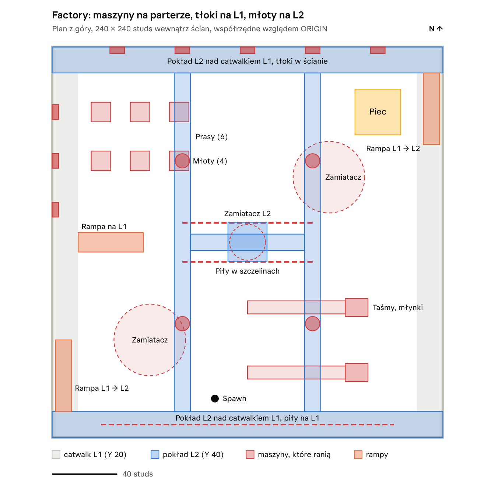

# Mapa Factory — instrukcja budowy

Stan na 19.11.2026 (FactoryKit zbudowany, zaimportowany i podłączony).

## Założenia

Factory to zamknięta, trójpoziomowa hala daleko od areny, pełna maszyn, które ranią i wyrzucają w powietrze wszystko, co ma Humanoida. Mapa już istnieje w `src/server/Factory.luau` i jest w menu jako FACTORY. Ten dokument opisuje ją tak, jak jest zbudowana, razem z zestawem z Blendera (FactoryKit), który nadaje maszynom wygląd.

**Zasada podziału:**

- Rozpada się: podłoga parteru, pokłady L1 i L2 (kafle `Map`) oraz rekwizyty (struktury `Map`: kontenery, zbiorniki, regały, beczki, wózki).
- Nie rozpada się: ściany, dach, rampy, rury, lampy i wszystkie maszyny. Maszyny pracują dalej, nawet gdy podłoga wokół nich jest zniszczona.
- Styl: każda część to klocek Plastic ze studsami. Funkcja `block()` wymusza Plastic bez względu na podany materiał, więc w hali nie ma neonu, a światło dają `PointLight`y.

**Liczby z kodu:**

| Parametr | Wartość | Stała |
| --- | --- | --- |
| Początek hali | `Vector3.new(600, 0, 0)`, hala zajmuje X od 476 do 724 | `ORIGIN` |
| Wnętrze | 240 × 240 studs (X i Z od −120 do 120) | `W = 120` |
| Dach | Y = 80 | `H` |
| Pokłady | L1 na Y = 20, L2 na Y = 40 | `L1`, `L2` |
| Catwalk przy ścianach | 16 szerokości, wewnętrzna krawędź na 104 | `RING`, `IN` |
| Kafel podłogi | 2 × 2, 4 głębokości | `FLOOR_TILE` |
| Kafel pokładu | 2 × 2, 1 grubości | `DECK_TILE` |
| Spawn | (−20, 4, −96), patrzy na północ | `SPAWN` |
| Chód / sprint gracza | 16 / 28 studs/s | klient |

Współrzędne w dokumencie są lokalne względem `ORIGIN`, w studach. X rośnie na wschód, Z na północ.

## Układ mapy

Parter jest pełen maszyn, a na górę prowadzą tylko trzy rampy: na zachód na L1, potem po obu stronach na L2. Nad całą halą, na wysokości 74, jeździ suwnica z hakiem opadającym do pokładu L2.

## Strefy po kolei

Hala ma pięć warstw: parter z ciężkimi maszynami, catwalk L1 z tłokami, pokład L2 z młotami, suwnicę pod dachem i powierzchnię ścian. Im wyżej, tym węższe przejścia i łatwiej spaść.

### A. Parter (Y = 0)

**Podłoga:** kafle 2 × 2 na całych 240 × 240. Kolory mówią, co gdzie jest:

- beton w szachownicę 8 × 8 (dwa odcienie szarości)
- białe linie alejek wzdłuż X = 0 i Z = 0
- niebieskie koło o promieniu 6 pod spawnem
- żółto-czarne pola 14 × 14 pod prasami
- ciemnożółte koła pod zamiataczami
- żółte szczeliny pił na Z = ±12

Pod podłogą leży ciemne dno 248 × 248 na Y = −5, więc dziura nigdy nie prowadzi w próżnię.

| Maszyna | Gdzie | Budowa | Ruch | Obrażenia / odrzut |
| --- | --- | --- | --- | --- |
| Prasy (6) | X −90, −66, −42; Z 50 i 80 | dwie kolumny 2×22×2, czerwona belka 18×3×7 na Y 23.5, głowica 12×3×12, chromowany tłok | cykl 3 s: 1.6 s u góry, uderzenie w 0.15 s do Y = 2, powrót 0.7 s; każda przesunięta o 0.7 s | 60, tylko w chwili uderzenia; 45 na bok i 15 w górę |
| Taśmociągi (2) | Z −40 i −80, X od 0 do 60 | gumowa taśma 60×1×8, żółte burty, chromowane rolki co 8 | taśma niesie z prędkością 14 i 20 studs/s (prędkość na przypiętej części) | — |
| Młynki na końcu taśm | X 67 | czerwona obudowa 14×12, lej, czerwona lampa, trzy wirujące wałki | wałki 14 rad/s | 15 co 0.25 s; wypluwa z powrotem nad taśmę (−30 X, 70 w górę) |
| Zamiatacze (2 na parterze) | (50, 40) i (−60, −60), promień 22 | piasta, czerwona lampa, dwa ramiona 1.6×1.6 | obrót 1.3 i −1.1 rad/s | 25 co 1 s; 60 stycznie, 15 na zewnątrz, 30 w górę |
| Piły w szczelinach (2) | Z ±12, X od −40 do 40 | chromowana tarcza śred. 8, czerwona piasta | tam i z powrotem, sinus t × 0.8 | 35 co 0.5 s; 70 w kierunku jazdy, 35 w górę |
| Piec | (80, 80) | basen lawy 28×28, bazaltowa krawędź, 4 nogi, okap 30×5×30, komin śred. 6 do dachu, 3 efekty ognia | — | 20 co 0.4 s; 65 w górę, losowo na boki |

**Rekwizyty na parterze (rozpadają się):** 5 kontenerów przy ścianach, 3 zbiorniki w narożnikach, 3 regały, 2 generatory, 2 szafki, 2 wózki widłowe, 4 grupy beczek, 3 grupy skrzyń, 2 odcinki rur. Pod catwalkiem stoją kolumny co 40 (X i Z = ±20, ±60, ±100).

### B. Catwalk L1 (Y = 20)

- Pierścień 16 szerokości wzdłuż wszystkich czterech ścian, kafle 2 × 2 × 1, krawędź żółta.
- Wejście z parteru: rampa 12 szerokości po zachodniej stronie, z (−64, 0, 0) do (−104, 20, 0).
- **Tłoki (8):** 5 w ścianie północnej (X −80, −40, 0, 40, 80) i 3 w zachodniej (Z 20, 50, 80). Czerwona płyta 9×8, chromowany taran 8×6×2 wysuwa się o 14 studs w poprzek catwalku. Cykl 2.4 s, wysunięcie w 0.15 s. Obrażenia 10, odrzut 90 od ściany i 25 w górę, czyli zrzuca z catwalku.
- **Piły na południowym catwalku (2):** Z = −112, jadą na 90 w obie strony, przesunięte o pół cyklu.
- Rekwizyty: regał, generator, odcinek rur.

### C. Pokład L2 (Y = 40)

- Północny i południowy pokład (nad catwalkiem L1), dwa długie mosty 10 szerokości na X = ±40, most poprzeczny na Z = 0 i platforma 24 × 24 na środku.
- Wejścia: rampa z L1 na wschodzie (113, 20, 60) → (113, 40, 104) i z L1 na zachodzie (−113, 20, −60) → (−113, 40, −104), obie 10 szerokości.
- **Zamiatacz na środku:** (0, 40, 0), promień 11, obrót 2 rad/s, wymiata z platformy.
- **Młoty wahadłowe (4):** nad mostami w (±40, ±50). Zawieszone na belce pod dachem (oś na Y 78), ramię 35 długości, czerwona głowica 4×6×9 z żółtym pasem. Wahnięcie ±1 rad, sinus t × 1.4. Obrażenia 30, odrzut 90 w bok i 30 w górę, czyli z mostu w dół.

### D. Pod dachem: suwnica

- Szyny na ścianie północnej i południowej na Y = 74, żółta belka 4×3×234 jeździ po X (sinus t × 0.25, ±100).
- Wózek jedzie po Z (sinus t × 0.6, ±90), a hak 4×4×4 opada od Y 72.5 do 44, czyli tuż nad pokład L2, i obraca się.
- Obrażenia 30, odrzut 70 od haka i 35 w górę. Na L2 trzeba się rozglądać także w górę.

### E. Ściany, dach, detale

- Ściany 4 grubości i dach 2 grubości, stal. Kratownice dachu co 30 i dwa jasne pasy świetlików na Z = ±60.
- Żółta listwa 1.5 wysokości u podstawy wszystkich ścian.
- Rury wzdłuż ścian północnej i południowej na Y 10, 30, 52, 66 (rdzawe śred. 2.4 na północy, stalowe 1.6 na południu). Pionowe piony na wschodzie i zachodzie co 30 (zielone w północnej połowie, rdzawe w południowej) z czerwonymi zaworami na Y 8.
- Kratki wentylacyjne 10×6 na południowej ścianie (Y 58) i żółte tablice ostrzegawcze 14×4 na północnej (Y 74).

## Zniszczalność

Factory korzysta z tego samego silnika zniszczeń co arena i port: kafle przez `Map.tile`, rekwizyty przez `Map.structure`. Własne jest tylko to, że każdy rekwizyt przechodzi przez `kind()`, który zamienia każdy klocek na Plastic ze studsami.

| Co | Jak | Wraca? |
| --- | --- | --- |
| Podłoga parteru | kafle 2×2×4; wybuch je chowa | tak, po `REGEN` = 25 s |
| Pokłady L1 i L2 | kafle 2×2×1, żółte na krawędziach | tak, po 25 s; gracz spada piętro niżej |
| Rekwizyty (kontenery, zbiorniki, regały, generatory, szafki, wózki, beczki, skrzynie, rury, kolumny) | struktury `Map`, klocki 4 albo 2 studs | tak, warstwami, gdy zniknie 90% albo po 45 s spokoju |
| Ściany, dach, rampy, rury, lampy | zwykłe części w folderze `Factory` | nie rozpadają się |
| Maszyny | zwykłe części poruszane co klatkę | nie rozpadają się, działają dalej nad dziurą |

**Dlaczego kafle mają 2 studs, a nie 1:** przy kaflach 1 × 1 (dzielonych 2 × 2) serwer miał ok. 224 000 części i 2 FPS. Kafle 2 × 2 to ok. 14 400 na parterze i ok. 7 000 na obu pokładach.

**Rodzaje rekwizytów (`KINDS` w `Factory.luau`):**

| Kind | Wygląd | Ile |
| --- | --- | --- |
| `Column` | ciemny słup 1×5 kostek | 36 (pod catwalkiem, na parterze i L1) |
| `ContainerRed/Blue/Green` | kontener 5×2×2 kostek, ciemne końce | 5 |
| `Tank` | chromowany zbiornik 3×3×4 z żółtym pasem i czerwonym zaworem | 3 |
| `Rack` | niebieski regał z żółtymi półkami i skrzyniami | 4 |
| `Generator` | ciemna podstawa, żółto-czerwony korpus, rury | 3 |
| `Lockers` | rząd szafek, niebieskie i szare | 2 |
| `Forklift` | żółty wózek z masztem i widłami | 2 |
| `Barrels` | czerwone i niebieskie beczki w grupie | 5 |
| `Boxes` | skrzynie areny (`Crates`) w plastiku | 4 |
| `PipeRun` | rdzawa rura na nogach z czerwonym zaworem | 3 |

**Uwaga przy zmianach:** maszyny stoją na kaflach, ale nie są z nimi połączone. Wybuch pod prasą robi dziurę, a prasa wisi i pracuje dalej. To celowe, maszyny mają być zawsze groźne.

## Blender: przygotowanie sceny

FactoryKit budujemy tak samo jak PortKit: skryptem w Pythonie, w osiach Roblox, w studach, jeden materiał na kolor. Różnica jest jedna: większość maszyn się rusza. Każda ruchoma część to więc osobny model z punktem zaczepienia dokładnie tam, gdzie kod ją obraca albo przesuwa.

**Pliki (kopia `assets/port` z poprawkami, gotowe):**

| Plik | Co robi |
| --- | --- |
| `assets/factory/build.py` | buduje 17 modeli i zapisuje `factory.blend`; klasa `Piece` z `assets/port/build.py` plus `stripes` (pasy ostrzegawcze z geometrii) i `funnel` (lej, okap) |
| `assets/factory/export.py` | prefiks `Factory_`, siatki `<Model>__<HEX>`, `FactoryKit.glb` + `manifest.json` (78 siatek, ok. 22 000 trójkątów) |
| `assets/factory/gen_install.py` | generuje `install.luau` |
| `assets/factory/install.luau` | układa siatki w `ReplicatedStorage.FactoryKit/<Model>` |

**Jednostki i osie:** 1 jednostka Blendera = 1 stud, opis w osiach Roblox, zamiana macierzą `R2B` jak w `assets/port/build.py`.

**Punkty zaczepienia (najważniejsze):** każdy model leży wokół punktu, który w `Factory.luau` dostaje CFrame co klatkę.

| Model | Punkt zaczepienia | Ruch w kodzie |
| --- | --- | --- |
| `Factory_PressFrame` | środek prasy na podłodze | stały |
| `Factory_PressHead` | środek głowicy | w pionie (`head.CFrame`) |
| `Factory_SweeperHub` | środek piasty na podłodze | stały |
| `Factory_SweeperArm` / `Factory_SweeperArmShort` | środek ramienia (oś obrotu); 44 na parterze, 22 na L2 | obrót wokół Y |
| `Factory_SawBlade` | środek tarczy | jazda po X + obrót |
| `Factory_Grinder` | środek dna obudowy młynka | stały |
| `Factory_GrinderRoller` | oś wałka | obrót |
| `Factory_Conveyor` | środek taśmy | stały |
| `Factory_Furnace` | środek basenu lawy | stały |
| `Factory_PistonPlate` / `Factory_PistonRam` | środek płyty w ścianie / środek tarana | stały / wysuw |
| `Factory_HammerBeam` / `Factory_HammerArm` | belka pod dachem / oś wahadła (góra ramienia) | stały / wahadło |
| `Factory_CraneBeam`, `Factory_CraneTrolley`, `Factory_CraneHook` | środek każdej części | po X / po Z / w pionie i obrót |

**Kolekcje:** `Factory_Machines` (stałe), `Factory_Moving` (ruchome), `Factory_Collision` (pomocnicze bryły z wymiarami części z kodu, nie eksportowane), `Reference` (hala 240×80×240 i sylwetka postaci 2×5×1).

**Paleta (hex z kodu):** stal `464A52`, ciemny `26282E`, żółty `EBB91E`, czerwony `D22823`, niebieski `285AA0`, zielony `3C7846`, rdza `8C4628`, lawa `FF6E14`, chrom `BEBEC3`.

**Decyzja:** maszyny zostają w stylu klocków: Plastic, kolory 1:1 z kodu, małe fazki, lepsze proporcje i detale. Siatki nie mają studsów.

## Blender: modelowanie maszyn

Każda siatka ma te same wymiary co część w kodzie, którą zastępuje. Ta część zostaje w grze jako niewidzialna strefa obrażeń i kolizja (tak jak w porcie). Dzięki temu trafienia i odrzuty działają dokładnie jak dziś.

### Modele i ich budżety

| Model | Wymiar X×Y×Z (studs) | Detale do dodania | Techniki | Trójkąty (max) |
| --- | --- | --- | --- | --- |
| `Factory_PressFrame` | 18×25×7 | kolumny z prowadnicami, belka z silnikiem i kablami, żółto-czarne pasy na kolumnach | Mirror, Bevel, Array (śruby) | 4 000 |
| `Factory_PressHead` | 12×3×12 + tłok | płyta z ryłami, czerwony pas, żebra na górze | Bevel, Inset | 1 500 |
| `Factory_Conveyor` | 60×1.6×9.6 | taśma z poprzecznymi listwami, burty z nitami, nogi, rolki | Array (listwy co 1, rolki co 8), Bevel | 5 000 |
| `Factory_Grinder` | 15×22×11 | obudowa z żebrowaniem, lej stożkowy, kratka ochronna, lampa | Bevel, Solidify (lej), Boolean (otwór) | 3 000 |
| `Factory_GrinderRoller` | 8.6×3×3 | wałek z zębami wzdłuż | Array obrotowe (12 zębów), Cylinder 16 ścian | 800 |
| `Factory_SweeperHub` | 3×8×3 + lampa | piasta z kołnierzem, lampa ostrzegawcza | Screw (profil), Bevel | 800 |
| `Factory_SweeperArm` | 44×1.6×1.6 (L2: 22) | dwuteownik z pasami ostrzegawczymi, końcówki z gumą | Extrude profilu I, Array (pasy) | 600 |
| `Factory_SawBlade` | 0.6×8×8 | tarcza z 24 zębami, otwory odciążające, czerwona piasta | Array obrotowe (Object Offset na pustym obiekcie obróconym o 15°), Boolean | 1 200 |
| `Factory_Furnace` | 30×92×30 (komin przez dach do daszka na Y 92) | okap z nitami, komin z obręczami, bazaltowa krawędź z kamieni, nogi z kratownicą | Solidify (okap), Array (obręcze, nity), Bevel | 6 000 |
| `Factory_PistonPlate` | 9×8×1 | rama w ścianie, węże hydrauliczne | Bevel, Curve (węże) | 1 000 |
| `Factory_PistonRam` | 8×6×2 + trzon | taran z płytą czołową i żółtym pasem, chromowany trzon | Bevel, Cylinder | 800 |
| `Factory_HammerBeam` | 12×2×2 | belka z łożyskiem osi | Bevel, Cylinder | 600 |
| `Factory_HammerArm` | 4×41×9 | ramię-kratownica i głowica z pasem | Array (kratownica), Bevel | 3 000 |
| `Factory_CraneBeam` | 4×3×234 | kratownica belki z kolorowymi końcami, wózki jezdne | Geometry Nodes (kratownica jak wysięgnik w porcie) | 8 000 |
| `Factory_CraneTrolley` | 6×3×6 | wózek z bębnem liny | Bevel, Cylinder | 1 200 |
| `Factory_CraneHook` | 4×4×4 | blok krążka i hak w kształcie J | Screw / Curve (hak), Bevel | 1 500 |

Wszystkie siatki razem to ok. 40 000 trójkątów, ale wiele z nich się powtarza (6 pras, 8 tłoków, 4 młoty). Klon siatki prawie nic nie kosztuje.

### Techniki krok po kroku

1. **Wymiar z kodu najpierw.** Pudło z kolekcji `Factory_Collision` w wymiarze części z `Factory.luau`, model budowany do jego obrysu. Nic nie może wystawać tam, gdzie gracz dostaje obrażenia, bo trafienie liczy strefa, nie siatka.
1. **Mirror** dla pras, młynków i tłoków: są symetryczne w X.
1. **Bevel** 0.15–0.3 stud, 2 segmenty, Limit Method = Angle 30°, Harden Normals. W klockowym stylu fazka ma być mała.
1. **Array obrotowe (piła, wałki młynka):** jeden ząb, pusty obiekt w osi obrócony o 360°/liczba zębów, Array z Object Offset na ten pusty obiekt. Potem Apply i Merge by Distance.
1. **Array liniowe:** listwy na taśmie co 1 stud, rolki co 8 (jak w kodzie), nity co 2, obręcze komina co 8.
1. **Geometry Nodes:** kratownica belki suwnicy, ta sama grupa węzłów co wysięgnik w porcie (Resample Curve co 4 → Instance on Points → Realize Instances).
1. **Screw:** profil piasty zamiatacza i blok krążka haka. Hak: krzywa w kształcie J z Bevel Depth 0.5, potem Convert to Mesh.
1. **Solidify:** okap pieca i lej młynka z jednej płaszczyzny, Thickness 0.4.
1. **Curve:** węże hydrauliczne tłoków i kable pras, Bevel Depth 0.15.
1. **Pasy ostrzegawcze** jako osobne ściany na przemian żółte i czarne (nie tekstura): Loop Cut co 1 stud i przypisanie materiałów.
1. **Ruchome części osobno:** głowica prasy, ramię zamiatacza, tarcza piły, wałek, taran, ramię młota, belka, wózek i hak to osobne modele. Ich punkt zaczepienia to oś ruchu z tabeli w sekcji o przygotowaniu sceny.

### Sprzątanie przed eksportem

- [ ] Apply modyfikatorów, Geometry Nodes po Realize Instances
- [ ] Merge by Distance 0.0005 i Delete Loose
- [ ] Normalne na zewnątrz, Face Orientation całe niebieskie
- [ ] Liczba trójkątów w budżecie, żadna siatka nad 19 000
- [ ] Punkt zaczepienia w osi ruchu, Apply All Transforms

## Blender: materiały i tekstury

FactoryKit nie potrzebuje tekstur: każdy kolor to osobna siatka, kolor ustawia `MeshPart.Color`, a materiał Plastic trzyma wygląd klocków reszty hali. UV nie jest potrzebne.

1. Materiały tworzy `material(hex)` z `assets/port/build.py`: nazwa = hex, Principled BSDF, kolor z hex przeliczony na liniowy, Roughness 0.6.
1. `export.py` dzieli każdy model po materiałach na siatki `<Model>__<HEX>`.
1. `install.luau` ustawia wykończenie według tabeli:

| Kolor | Materiał Roblox | Uwagi |
| --- | --- | --- |
| wszystkie poza poniższymi | `Plastic` | jak klocki hali |
| chrom `BEBEC3` (tarcze, tłoki, wałki) | `Metal` | Reflectance 0.1, błyszczy przy ruchu |
| lawa `FF6E14` | `Neon` | jedyny neon w hali, świeci w basenie pieca |
| rdza `8C4628` | `Plastic` | bez `CorrodedMetal`, który kłóci się ze studsami |

Jeśli kiedyś przyda się tekstura (np. brud na okapie pieca), droga jest ta sama co w dokumencie portu: UV, malowanie w Texture Paint albo `paint_texture.py` ze skilla `roblox-3d-model`, PNG i `SurfaceAppearance` ustawiany w Studio. Przed wysłaniem obrazu: żadnej krwi ani niczego, co można tak odczytać.

## Eksport i import do Roblox Studio

Eksport i import to ta sama droga co w porcie, sprawdzona na PortKit: jeden plik `.glb`, File → Import 3D, skrypt instalacyjny, zapis miejsca. Nowe jest tylko podłączenie ruchomych siatek.

### Eksport (`assets/factory/export.py`)

1. Bierze obiekty z prefiksem `Factory_`, dzieli je na siatki po kolorze (`<Model>__<HEX>`).
1. Zanim zrobi nowe siatki, usuwa osierocone stare. Bez tego nazwy dostają końcówkę „.001”, a instalator czyta kolor z nazwy.
1. Odkrywa kolekcję `Export` przed zaznaczeniem. Ukryta zostaje po poprzednim eksporcie i drugi eksport zapisywał pusty plik.
1. Obraca siatki o 180° wokół Z Blendera, sprawdza limit 19 000 trójkątów, zapisuje `manifest.json` (środek każdej siatki w przestrzeni modelu).
1. Ustawienia glTF: Binary, +Y Up, Apply Modifiers, Materials Export, bez animacji, kamer, świateł i Draco.

### Import

1. Studio (tryb edycji) → File → Import 3D → `FactoryKit.glb`, ustawienia domyślne. Powstaje model „Scene”.
1. `install.luau` w trybie edycji: przenosi siatki do `ReplicatedStorage.FactoryKit/<Model>`, ustawia kolor, materiał, `DoubleSided = true`, `RenderFidelity = Precise`, atrybut `Place` z obrotem 180° wokół Y (importer obraca każdą siatkę).
1. Zapis miejsca (Ctrl+S). FactoryKit, tak jak PortKit i ArmyKit, żyje tylko w pliku miejsca.

### Podłączenie w `Factory.luau`

- **Stałe maszyny:** klon siatek w miejscu części, części zastępcze ukryte (`Transparency = 1`), ale dalej kolidują. To ten sam wzorzec co `fromKit` i `hide` w `Port.luau`.
- **Ruchome maszyny:** siatka nie jest przypięta (`Anchored = false`), ma `Massless = true` i `CanCollide = false`, a `WeldConstraint` łączy ją z częścią, którą kod przesuwa co klatkę. Gdy kod ustawia CFrame tej części, siatka jedzie razem z nią, więc kodu ruchu nie trzeba zmieniać.
- **Strefy obrażeń bez zmian:** `GetPartsInPart` dalej pyta o te same, teraz niewidzialne części.
- **Bez zestawu** hala buduje się dokładnie jak dziś.
- W kodzie: `fromKit(piece, pivot)` dla stałych, `fromKit(piece, nil, part, offset, recolor)` dla ruchomych i `hide(parts)`. Drugie ramię zamiatacza dostaje kolor czerwony przez `recolor`. Ramię młota jest modelowane wokół osi wahadła, więc ma `offset` = połowa długości ramienia w górę.
- Tłok ma nowy chromowany trzon (część, rozciągana co klatkę jak trzon prasy) od ściany do tyłu tarana.
- Wynik w Studio: 290 klonów siatek, 151 przyspawanych do 41 ruchomych części; spaw nie dryfuje (zmierzone 0.000 przez 2 s na kliencie).

## Oświetlenie, efekty i dźwięk

Halę oświetla 62 `PointLight`y i ciemne otoczenie, które klient włącza po wybraniu mapy. Dźwięków w kodzie Factory jeszcze nie ma.

### Otoczenie (klient)

Gdy atrybut gracza `Map` = `FACTORY`, `init.client.luau` ustawia preset `INSIDE`: Ambient (20, 20, 20), `EnvironmentDiffuseScale` 0, `EnvironmentSpecularScale` 0. Światło nieba nie zatrzymuje się na dachu i zalewałoby wnętrze, więc robią to tylko lampy. Po wyjściu wraca preset `OUTSIDE`.

### Lampy

| Gdzie | Ile | Zasięg |
| --- | --- | --- |
| pod dachem (Y 76.5), siatka X i Z = ±30, ±90 | 16 | 60 |
| pod mostami L2 (X ±40, Z ±30/60/90) i przy środku (X ±20, Z 0) | 14 | 55 |
| pod catwalkami L1 i L2 przy ścianach | 32 | 36 |

Lampy z dachu nie sięgają parteru (zasięg `PointLight` kończy się na 60), dlatego wiszą też pod mostami. Każda lampa to płytka 4×0.6×4 w ciepłym kolorze (255, 240, 210), Brightness 1.2, bez cieni.

### Efekty, które już są

- 3 efekty `Fire` w basenie pieca (Size 14, Heat 10) i czerwone światło lawy (zasięg 40, Brightness 4).
- Czerwone lampy ostrzegawcze nad młynkami (zasięg 20).
- Ruch maszyn: prasy, wałki, ramiona, piły, tłoki, młoty i suwnica.
- Iskry (`sparks`): z każdej piły stale, z miejsca, gdzie tarcza wchodzi w podłogę (piasta piły już się nie obraca, więc emiter stoi w miejscu), i wybuch iskier spod głowicy prasy w chwili uderzenia (faza 1.72–1.86).
- Para (`puff`) po obu stronach płyty tłoka przy wysunięciu (faza 1.3–1.6).
- Dym z komina pieca nad dachem (Y 91 z zestawem, 83 bez), tekstura `smoke_main.dds` jak w porcie.
- Dźwięki z istniejącego `Sfx`: brzęk metalu przy uderzeniu prasy i przy wysunięciu tłoka (`Sfx.METAL` z niższym tonem).
- Emitery z czasem przełącza `switch`, który zapisuje `Enabled` tylko przy zmianie (każdy zapis się replikuje). Razem 27 emiterów.

### Do dodania (propozycja)

- Dźwięki w pętli z Creator Store przez skill `roblox-sfx`, każdy sprawdzony w Studio (`IsLoaded` i zmierzona długość):

| Dźwięk | Źródło | Kiedy |
| --- | --- | --- |
| uderzenie prasy | głowica prasy | w chwili uderzenia (faza 1.6–1.75 cyklu) |
| wycie piły | tarcza | pętla, RollOffMaxDistance 50 |
| szum taśmy i młynka | taśma, obudowa młynka | pętla |
| syk tłoka | płyta tłoka | przy wysunięciu (faza 1.3) |
| świst młota | głowica młota | przy przejściu przez środek |
| huk pieca | basen lawy | pętla |
| szum silnika suwnicy | wózek | pętla |
| tło hali (buczenie, metal) | cała hala | pętla, cicho |

Ruch maszyn liczy się z zegara serwera (`os.clock()`), którego klient nie zna. Żeby dźwięki grał klient bez ruchu w sieci, ruch musiałby liczyć się z `workspace:GetServerTimeNow()`, który jest taki sam po obu stronach. Inaczej dźwięki odpala serwer, przy części, która już się replikuje.

## Rozgrywka i podłączenie w kodzie

Factory jest w pełni podłączona: serwer buduje ją przy starcie, menu ma ją jako FACTORY, a maszyny ranią przez funkcję `hurt` z głównego skryptu.

### Gdzie co jest w kodzie

1. **`src/server/Factory.luau`:** `Factory.SPAWN`, `Factory.DUMMY_SPOTS` i `Factory.build(hurt)`.
1. **`src/server/init.server.luau`:** `FACTORY = Factory.SPAWN` w `SPAWNS`, wywołanie `Factory.build(...)` z funkcją, która graczy rzuca przez `knockPlayer`, a manekiny wywraca, oraz manekiny z `Factory.DUMMY_SPOTS`.
1. **`src/client/Menu.luau`:** `"FACTORY"` w `MAPS`.
1. **`src/client/init.client.luau`:** preset oświetlenia `INSIDE` i zdalne zdarzenie `Hazard`. Klient sam ustawia prędkość swojej postaci, bo to on jest właścicielem jej fizyki.

### Pętla maszyn

- Co klatkę (`Heartbeat`) serwer sprawdza, czy któryś gracz jest w promieniu hali (do 60 studs za ścianami). Jeśli nie, maszyny stoją, żeby nie wysyłać ruchu dziesiątek części przez sieć. Ruch to funkcja zegara, więc po powrocie maszyny są tam, gdzie powinny.
- Dla każdej z 32 stref obrażeń `GetPartsInPart` szuka tylko postaci graczy i manekinów (folder `Dummies`).
- Każdy model może oberwać od danej strefy raz na jej czas odnowienia (od 0.25 s młynka do 1 s prasy).
- Prasy i tłoki ranią tylko w chwili ruchu (faza „uzbrojona”). Opieranie się o stojącą prasę jest bezpieczne.

### Punkty startowe

- **Gracz:** (−20, 4, −96), na niebieskim kole, patrzy na północ w stronę pras.
- **Manekiny (12):** 8 na parterze, 3 na L1 (Y 24) i 1 na środkowej platformie L2 (Y 44).

### Wanted, policja, wojsko, helikopter

- Fala policji szuka miejsca 45–65 studs od gracza promieniem z 60 w górę. Punkty za ścianą nie mają podłogi i są odrzucane.
- Od zmian dla portu punkty o ponad 12 studs wyżej niż gracz też są odrzucane, więc policjanci nie pojawiają się na catwalku nad graczem stojącym na parterze.
- **Helikopter przy 5 gwiazdkach:** w hali by zawisł pod dachem albo w nim i przelatywał przez ściany. Dlatego gdy gracz ma `Map` = `FACTORY`, `Wanted.luau` zamiast helikoptera wysyła jego trzech Heavych pieszo, przez ten sam `spawnNear` co resztę fali.

## Wydajność i budżety

Factory to najcięższa mapa w grze: ok. 21 000 kafli i kilkaset części, które serwer porusza co klatkę, gdy ktoś jest w środku. To liczby z kodu. Pomiaru w Studio dla samej hali jeszcze nie było.

### Części (z kodu)

| Element | Ile | Uwagi |
| --- | --- | --- |
| kafle parteru 2×2 | 14 400 | `CastShadow` wyłączone |
| kafle L1 (pierścień 16 szerokości) | ok. 3 600 |  |
| kafle L2 (pokłady, mosty, platforma) | ok. 3 300 |  |
| klocki rekwizytów | kilkaset | 72 struktury |
| powierzchnia hali, rury, lampy | ok. 130 | nie rozpadają się |
| części maszyn | ok. 160 | z tego ok. 70 ruszanych co klatkę |

Dla porównania port ma ok. 9 800 części. Przy kaflach 1 × 1 Factory miała ok. 224 000 części i 2 FPS na serwerze, stąd kafle 2 × 2.

### Koszty w każdej klatce

- Ruch maszyn: ok. 70 części dostaje nowy CFrame i replikuje się do klientów. Tylko gdy gracz jest w hali.
- 32 zapytania `GetPartsInPart`, każde ograniczone do postaci i manekinów.
- 62 `PointLight`y bez cieni.

### Budżety dla FactoryKit

| Rzecz | Limit | Uwagi |
| --- | --- | --- |
| trójkąty na siatkę | 19 000 | Roblox odrzuca powyżej ok. 20 000 |
| cały zestaw (bez powtórzeń) | ok. 40 000 | tabela modeli |
| `EditableMesh` | 0 | siatki z importu nie zjadają limitu 8 w kliencie |
| nowe części w grze | ok. 0 | siatka zastępuje wygląd części, która i tak jest |
| przyspawane siatki na ruchomych maszynach | ok. 40 | ruszają się razem z częścią, bez dodatkowych zapisów CFrame |

### Jak mierzyć

Według skilla `roblox-performance`: MicroProfiler (Ctrl+F6) z graczem w hali i bez, okno Stats (części, pamięć), Developer Console → Network (ile danych wysyła ruch maszyn). Pomiar przed i po FactoryKit na tym samym komputerze, wynik liczbami.

## Weryfikacja i odbiór

Każda zmiana w hali przechodzi ten sam zestaw sprawdzeń: maszyny mają ranić tak samo jak przed zmianą, a liczba części nie może urosnąć.

### Przed zmianą (prover `roblox-map`)

Układ hali zapisany jako spec JSON skilla `roblox-map` (parter, pierścień L1, pokłady L2, rampy, spawny) z ruchem tej gry (chód 16, sprint 28, skok, double jump, wall jump). Prover odpowiada na pytania:

- czy z parteru da się dojść na L1 i L2 tylko rampami (bez double jumpa)
- czy z każdej dziury w pokładzie spada się na podłogę niżej, a nie w szczelinę bez wyjścia
- czy spawn i manekiny stoją na podłodze
- czy rampy mają nachylenie, po którym się chodzi

### Test w Studio (skill `roblox-playtesting`)

- [ ] Menu → FACTORY → PLAY: gracz staje na niebieskim kole, oświetlenie przechodzi na `INSIDE`.
- [ ] Każdy typ maszyny trafia i odrzuca: prasa (60), młynek (15, wyplucie), zamiatacz (25), piła (35), piec (20), tłok (10, zrzut z catwalku), młot (30, zrzut z mostu), hak suwnicy (30).
- [ ] Stojąca prasa i schowany tłok nie ranią.
- [ ] Granat na pokładzie L2: kafle znikają, gracz spada piętro niżej, kafle wracają po 25 s.
- [ ] Wybuch pod prasą: dziura w podłodze, prasa pracuje dalej.
- [ ] Gracz wychodzi z hali: maszyny stają; wraca: są tam, gdzie powinny.
- [ ] 3 gwiazdki w hali: żaden policjant nie pojawia się na catwalku nad graczem ani za ścianą.
- [x] Z FactoryKit: siatki stoją na miejscu części, ruchome jadą razem z nimi (sprawdzone na zrzutach i pomiarem spawów). `ZFight` dla części jeszcze nie liczony.
- [ ] Pomiary z sekcji o wydajności wpisane liczbami, przed i po zestawie.

### Zasady

- Żadnych prawdziwych marek ani logo na maszynach.
- Żadnych tekstur z krwią, także na piłach i prasach.
- Bez publikowania assetów i bez skryptów uploadu bez zgody, zgodnie z `AGENTS.md`.
