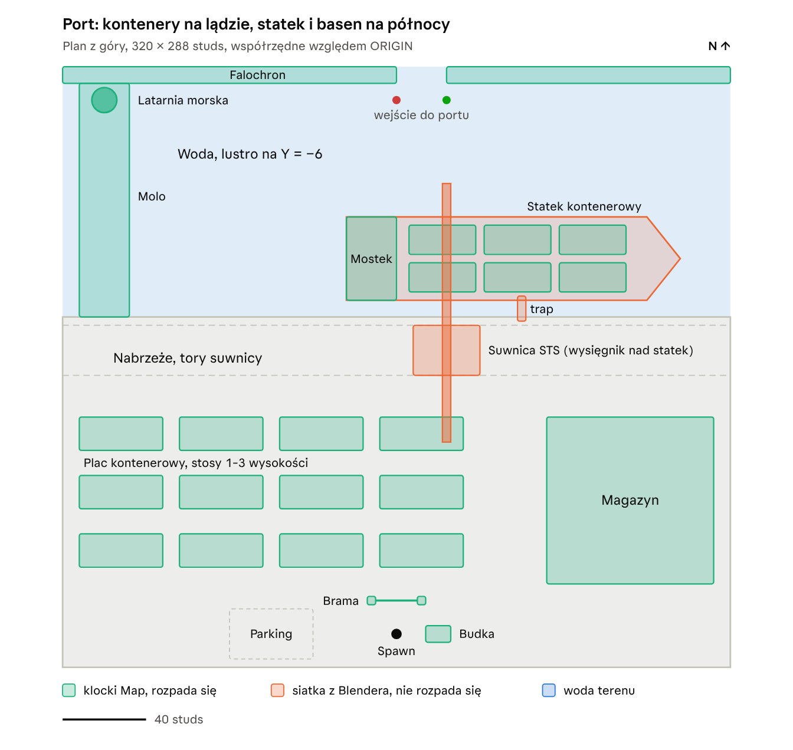

# Mapa Port / Doki — instrukcja budowy

Stan na 19.11.2026.

## Założenia

Port to czwarta dzielnica Ragdoll Mayhem: zniszczalny teren z kontenerami, suwnicą, statkiem i wodą, do którego wpada się ragdollem. Budujemy go tak samo jak Factory i City: osobny moduł `src/server/Port.luau` w osobnym miejscu świata, pozycja w menu map.

**Zasada podziału (najważniejsza decyzja projektu):**

- Wszystko, co ma się rozpadać, to klocki `Map` (podłoga z kafli, struktury z `KINDS`). Dotyczy to kontenerów, magazynu, latarni, mola, nadbudówki statku i falochronu.
- Wszystko, co jest duże, krzywe albo zbyt szczegółowe na klocki, to siatki z Blendera. Nie rozpadają się, kolizję dają im niewidzialne bloki. Są to: suwnica, kadłub statku, wózki, łódki, latarnie uliczne, pachołki i odbijacze.

**Liczby z kodu, których trzymamy się wszędzie:**

| Parametr | Wartość | Skąd |
| --- | --- | --- |
| Jednostka siatki (`CUBE`) | 4 studs | `Map.luau` |
| Kafel podłogi dzielnicy | 2 studs (po trafieniu) | `FLOOR_TILE` w Factory i City |
| Początek dzielnicy (`ORIGIN`) | `Vector3.new(0, 0, 640)`, do potwierdzenia | arena kończy się na 256, Factory jest na +600 X, City na −600 X |
| Obszar | X od −160 do 160, Z od −144 do 144 (320 × 288 studs) | ten dokument |
| Wysokość nabrzeża (góra podłogi) | Y = 0 | jak arena |
| Lustro wody | Y = −6 | ten dokument |
| Chód / sprint gracza | 16 / 28 studs/s | `WALK_SPEED`, `SPRINT_SPEED` w kliencie |
| Ruch w powietrzu | skok, double jump (UP 65), wall run, wall jump (UP 55) | `init.client.luau` |

Wszystkie wymiary w dokumencie są w studach i w lokalnych współrzędnych dzielnicy (względem `ORIGIN`). X rośnie na wschód, Z na północ, w stronę morza. Każdy wymiar to wielokrotność 4, chyba że napisano inaczej.

## Układ mapy



Ląd zajmuje południowe 168 studs, woda północne 120. Wysięgnik suwnicy sięga nad statek, a jedyne wyjście z basenu na otwarte morze to przerwa w falochronie między bojami.

## Strefy po kolei

Port ma osiem stref, od bramy na południu do falochronu na północy. Gracz idzie od lądu w stronę wody, a im bliżej morza, tym wyżej i groźniej.

### A. Brama i parking (Z od −144 do −112)

- **Spawn:** `Port.SPAWN = CFrame.lookAt(ORIGIN + (0, 5, −128), ORIGIN + (0, 5, 0))`, gracz patrzy na plac i suwnicę.
- **Brama:** dwa słupy 4×4×16 (beton, kind `Pillar`), między nimi szlaban 24 długości (biało-czerwone pasy co 4). Szlaban to klocki, więc da się go zestrzelić.
- **Budka strażnika:** 12×8×12, pusta w środku, okno 8×4 od strony drogi z neonowym, żółtym szkłem. Stoi na X = 20.
- **Parking:** asfalt z białymi liniami co 12, cztery miejsca, dwa wraki aut (siatki z Blendera, przypięte, bez fizyki).
- **Ogrodzenie:** wzdłuż X = ±160 na lądzie mur z klocków (kind `Wall`) wysokości 8, na górze drut kolczasty (siatka z Blendera).

### B. Plac kontenerowy (Z od −104 do −20, X od −152 do 32)

- **Kontener:** 40×16×16 (długość wzdłuż X). To powłoka z kostek 4-studowych (10×4×4), pusta w środku, wnętrze 32×8×8, więc gracz się mieści. Jedna ściana czołowa to drzwi.
- **Wariant otwarty:** bez ściany drzwi, gracz może wejść do środka. Mniej więcej co trzeci kontener.
- **Układ:** trzy rzędy (środki na Z = −88, −60, −32), w rzędzie cztery stanowiska (środki na X = −132, −84, −36, 12). Między rzędami alejki 12 szerokości, między stanowiskami 8.
- **Stosy:** wysokość 1–3 kontenery (16, 32, 48 studs), rozkład schodkowy (1-2-3-2), żeby dało się wejść na górę skokiem, double jumpem albo wall runem. Wyjątek: stanowisko X = 12 w rzędzie Z = −32 leży pod zapleczem wysięgnika suwnicy (Y = 44), więc tam najwyżej 2 kontenery (32).
- **Kolory kontenerów:** czerwony `B8432F`, niebieski `2F5FA8`, zielony `3C8A4A`, pomarańczowy `E07A2A`, żółty `E0B42A`, szary `7A7E86`. Jeden kolor na kontener, losowany ze stałym ziarnem, żeby mapa wyglądała zawsze tak samo.
- **Detale z klocków:** pionowe żeberka co 4 (co drugi pas o ton ciemniejszy), narożniki w ciemniejszym kolorze.
- **Detale z Blendera (dokładane na kontener, nie łamią się):** ryły zamków na drzwiach, numer i logo zmyślonej firmy jako płaskie elementy.
- **Drabiny:** `TrussPart` 2 szerokości na co drugim stosie 3-poziomowym (natywnie wspinalne w Roblox).
- **Pojazdy:** wózek widłowy i reach stacker jako siatki z Blendera, przypięte, kolizja z bloku.

### C. Magazyn (X od 72 do 152, Z od −104 do −24)

- **Bryła:** 80×80, wysokość 32, ściany i dach z klocków (pusta powłoka jak budynki w City). Wybuch robi dziurę w dachu, a przecięcie ściany zrzuca to, co było nad nią.
- **Bramy:** dwie bramy rolowane 24×20 (zachodnia i północna), płyta bramy z poziomych pasów w kolorze stali.
- **Środek:** antresola na Y = 16 wzdłuż ściany wschodniej (16 głębokości), schody z kroków 2-studowych.
- **Regały:** cztery rzędy 4×32×24 z półkami co 8 i paletami z kartonami. Kartony to klocki, rozsypują się po trafieniu.
- **Napis na ścianie:** „DOCK 7” z neonowych klocków (jak billboardy w City).
- **Beczki z paliwem (propozycja nowej mechaniki):** 6 czerwonych beczek przy magazynie. Trafienie wywołuje `Map.blast(pozycja, 9, 70)`, czyli tyle, co granat.

### D. Nabrzeże (Z od −16 do 24, cała szerokość)

- **Nawierzchnia:** betonowe płyty 8×8 w dwóch odcieniach, krawędź 2 studs w żółto-czarne pasy ostrzegawcze.
- **Ściana nabrzeża:** od Y = 0 do dna, ciemny beton, plamy rdzy i glonów w kolorze klocków przy linii wody.
- **Tory suwnicy:** dwie szyny na Z = −4 i Z = 20, wpuszczone w beton (ciemna stal, 1 studs szerokości).
- **Pachołki cumownicze:** co 16 wzdłuż Z = 22 (Blender, żeliwo, czarne z żółtym czubkiem).
- **Odbijacze:** opony co 12 na ścianie nabrzeża (Blender, cylinder z modyfikatorem Screw).
- **Drabiny z wody:** `TrussPart` co 48 na ścianie nabrzeża, od dna do Y = 0. Muszą być: gracz w wodzie ma wyjście w zasięgu najwyżej 24 studs.
- **Latarnie:** co 32, słup 16 wysokości, światło `SpotLight` w dół (Blender + światło Roblox).

### E. Suwnica STS (na torach, X = 24)

- **Portal:** cztery nogi przekroju 4×4, rozstaw 24 (Z) na 32 (X), belka portalu na Y = 40.
- **Maszynownia:** skrzynia 24×12×12 na portalu (Y od 40 do 52).
- **Wysięgnik:** kratownica 4×4, od Z = −36 (zaplecze) do Z = 88 (nad statkiem), na Y = 44. Ciągi lin do A-ramy na Y = 64.
- **Wózek z kabiną:** na Z = 64, pod nim spreader (rama do kontenerów) na linach, zawieszony na Y = 24.
- **Kolory:** główny błękit `2E6FB0`, białe paski, żółte bariery, czerwone światła ostrzegawcze (neon) na czubku wysięgnika.
- **Rozgrywka:** w jednej nodze drabina (`TrussPart`) na platformę Y = 40. Po wysięgniku da się przejść (niewidzialna płyta 4 szerokości na górze) i skoczyć do wody z 50 studs.
- **Nie rozpada się.** To siatka z Blendera, kolizja z ok. 20 niewidzialnych bloków.

### F. Statek kontenerowy (X od −24 do 136, Z od 32 do 72)

- **Kadłub:** 160×40, burta od dna Y = −20 do pokładu Y = 8 (14 studs nad wodą). Dziób ostry na wschodzie, rufa płaska na zachodzie. Czarny kadłub, czerwone dno pod linią wody, biała linia wodna, nazwa na burcie (zmyślona).
- **Pokład:** kafle `Map` (rozpadają się i odrastają). Pod pokładem dwie ładownie 48×32, dno na Y = −12, gdzie wpada się przez dziury w pokładzie.
- **Kontenery na pokładzie:** dwa rzędy po trzy stanowiska, 1–2 wysoko.
- **Nadbudówka (rufa, X od −24 do 0):** 24×40, cztery kondygnacje po 8 (do Y = 40), mostek z oknami (neonowe szkło) na górze. Z klocków, więc da się wybić okna i podciąć całą wieżę.
- **Komin:** za mostkiem, 8×12×16, czerwony z białym pasem, dym z `ParticleEmitter`.
- **Trap:** z nabrzeża (X = 60, Z = 22) na pokład (X = 60, Z = 34), szerokość 4, poręcze. Nachylenie ok. 34°.
- **Cumy:** od pachołków do burty, krzywe z Blendera (bez kolizji).

### G. Molo drewniane i latarnia (X od −152 do −128, Z od 24 do 136)

- **Molo:** pomost 24 szerokości na palach (słupy co 8, Blender). Deski to kafle `Map` w kolorze drewna, więc po wybuchu wpada się do wody, a deski odrastają po `REGEN`.
- **Barierki:** drewniane, co 4, wysokość 4.
- **Łódka rybacka:** przycumowana do mola, siatka z Blendera. Bujanie robi klient (mały `TweenService` w pionie, jak obracanie wirników helikoptera).
- **Latarnia morska (koniec mola, Z = 128):** wieża 12×12, wysokość 48, pasy czerwono-białe co 8, pusta w środku, drabina `TrussPart` na górę. Na szczycie laterna z neonowym szkłem i obracającym się `SpotLight`. Z klocków, przecięcie pierścienia zwala górę wieży.

### H. Woda i falochron (Z od 24 do 144)

- **Woda:** woda terenu (`Terrain:FillBlock(..., Enum.Material.Water)`) od Z = 24 do 144, lustro na Y = −6, dno na Y = −26. Da się pływać.
- **Dno:** teren z materiałem `Mud` i `Rock`, kilka skrzyń i opon na dnie.
- **Falochron:** pas kamieni na Z od 136 do 144 (kind `Rock`, już istnieje), z przerwą 24 na wschód od środka (wejście do portu). Zamyka basen, więc nie da się odpłynąć z mapy.
- **Boje:** dwie przy wejściu, czerwona i zielona, neonowe światło na czubku (Blender + `PointLight`).
- **Krawędzie:** niewidzialne ściany na X = ±160 nad wodą, do Y = 80.

## Zniszczalność

Nic nowego w silniku zniszczeń nie trzeba: port używa `Map.tile` na podłogi i `Map.structure(kind, cframe)` na wszystko, co stoi, dokładnie tak jak `Factory.luau:94` i `City.luau:470`. Nowe są tylko rodzaje struktur w `Map.KINDS`, dopisane w `Port.luau`.

**Co się dzieje po trafieniu (zachowanie już istniejące w `Map.luau`):**

- Kafel podłogi albo kostka struktury dzieli się na małe kawałki dopiero wtedy, gdy coś w nią trafi.
- Kafle podłogi (nabrzeże, pokład, molo) chowają się i wracają po `REGEN` = 25 s.
- Struktura bez połączenia z ziemią spada (`settle`). Przecięty stos kontenerów albo latarnia zwalają się w całości.
- Struktura odbudowuje się, gdy zniknie 90% kostek (`REBUILD_AT`) albo po 45 s spokoju (`IDLE_REPAIR`). Kostki wsuwają się warstwami.

**Nowe rodzaje struktur:**

| Kind | Wymiar (studs) | Kostki | Uwagi |
| --- | --- | --- | --- |
| `Container` | 40×16×16 | ok. 128 | powłoka 10×4×4, drzwi z jednej strony, kolor jako argument |
| `ContainerOpen` | 40×16×16 | ok. 124 | bez ściany drzwi, da się wejść |
| `Warehouse` | 80×32×80 | ok. 1000 | ściany i dach, dwie bramy 24×20 |
| `Shelf` | 4×24×32 | ok. 60 | regał z kartonami (`Crates` w mniejszej skali) |
| `Lighthouse` | 12×48×12 | ok. 200 | pusta wieża 3×3, pasy co 2 warstwy, laterna z neonu |
| `Superstructure` | 24×40×40 | ok. 700 | nadbudówka statku, cztery kondygnacje, okna z neonu |
| `Guardhouse` | 12×12×8 | ok. 40 | budka strażnika |
| `Barrier` | 24×4×1 | 6 | szlaban w pasy |
| `Barrel` | 4×4×4 | 1 | beczka z paliwem, wybuch po trafieniu (nowa mechanika) |

Już istniejące rodzaje, których używamy wprost: `Wall` (mur na granicy), `Rock` (falochron), `Pillar` (słupy bramy), `Crates` (skrzynie na nabrzeżu).

**Szkic kontenera (ten sam wzorzec co `KINDS.Tower`):**

```lua
-- 40x16x16 studs: 10 x 4 x 4 cubes, hollow, doors at x = 4.5
local function container(color: Color3, open: boolean)
	return function(add)
		for x = -4.5, 4.5 do
			for y = 0, 3 do
				for z = -1.5, 1.5 do
					local shell = math.abs(x) == 4.5 or y == 0 or y == 3 or math.abs(z) == 1.5
					local door = open and x == 4.5 and y > 0 and y < 3 and math.abs(z) < 1.5
					if shell and not door then
						local rib = (x + 4.5) % 2 == 1 -- every other cube one shade darker
						add(x, y, z, rib and color:Lerp(Color3.new(), 0.15) or color, Enum.Material.CorrodedMetal)
					end
				end
			end
		end
	end
end
KINDS.ContainerRed = container(Color3.fromHex("B8432F"), false)
```

Stos to kilka wywołań `Map.structure` z Y = 0, 16, 32. Każdy kontener jest osobną strukturą, więc zestrzelony dolny zrzuca te nad nim (jeśli stoją na nim i nie dotykają niczego innego).

**Czego nie da się zniszczyć:** dno i ściana nabrzeża (skała pod podłogą, jak bedrock areny), kadłub statku, suwnica, pale mola, woda. Dzięki temu mapa nigdy nie znika do zera.

## Blender: przygotowanie sceny

Port robimy w Blenderze tak samo jak zestaw wojskowy (`assets/army`): modele są budowane skryptem w Pythonie, nie klikane ręcznie. Dzięki temu każdą poprawkę da się odtworzyć jednym uruchomieniem. Wszystko trafia do nowego folderu `assets/port/`.

**Pliki (wzorowane 1:1 na `assets/army`):**

| Plik | Co robi |
| --- | --- |
| `assets/port/build.py` | buduje każdy model w otwartym Blenderze i zapisuje `port.blend` |
| `assets/port/export.py` | dzieli modele na siatki po kolorze, eksportuje `PortKit.glb` i `manifest.json` |
| `assets/port/gen_install.py` | z manifestu generuje `install.luau` |
| `assets/port/install.luau` | uruchamiany raz w Studio, układa siatki w `ReplicatedStorage.PortKit` |

Uruchamianie w Blenderze (Scripting → Python Console albo przez MCP Blendera):

```python
exec(open(r"<repo>/assets/port/build.py").read())
exec(open(r"<repo>/assets/port/export.py").read(), {"__file__": r"<repo>/assets/port/export.py"})
```

**Jednostki i osie:**

- Scene Properties → Units: Unit System = None (albo Metric ze Unit Scale = 1). **1 jednostka Blendera = 1 stud.** Nie przeliczamy na metry.
- Modele opisujemy w osiach Roblox (x w prawo, y w górę, przód = −Z) i zamieniamy przy tworzeniu macierzą `R2B = ((-1,0,0),(0,0,1),(0,1,0))`, jak w `assets/army/build.py`. Współrzędne z tego dokumentu przenosi się więc bez przeliczania.
- Punkt zaczepienia (origin) każdego modelu: na środku podstawy, na ziemi (suwnica: środek między torami; statek: środek kadłuba na linii pokładu; pachołek: środek podstawy).
- Apply → All Transforms przed eksportem (Scale = 1, Rotation = 0).

**Kolekcje (Outliner):**

- `Port_Crane` — suwnica i wszystkie jej części
- `Port_Ship` — kadłub, komin, relingi, nazwa
- `Port_Props` — pachołki, odbijacze, latarnie, boje, drut kolczasty
- `Port_Vehicles` — wózek widłowy, reach stacker, wraki, łódka
- `Port_Collision` — pomocnicze pudła kolizji (nie eksportowane, tylko do odczytu wymiarów)
- `Export` — tworzy ją `export.py`, nie ruszamy ręcznie
- `Reference` — bryła 320×288 na Y = 0 i sylwetka postaci 2×5×1, żeby od razu widzieć skalę

**Nazewnictwo:**

- Obiekt: `Port_<Model>`, np. `Port_Crane`, `Port_Bollard`, `Port_Hull`. Prefiks `Port_` jest jak `Soldier_` w zestawie wojskowym: po nim `export.py` wybiera, co eksportować.
- Materiał: nazwa = kolor hex bez `#` (np. `2E6FB0`). Jeden materiał na kolor, bo kolor w Roblox niesie `MeshPart.Color`.
- Siatka po eksporcie: `<Model>__<HEX>`, np. `Port_Crane__2E6FB0`.

**Widok roboczy:** Viewport Shading = Solid, Color = Material; nakładki Statistics (liczba trójkątów) i Face Orientation (niebieskie = dobrze, czerwone = odwrócone normalne) włączone przez całą pracę.

## Blender: modelowanie

Styl jest ten sam co w broni i zestawie wojskowym: grube, sfazowane bryły, płaskie nasycone kolory, mało drobnicy. Siatki stoją obok klocków z `Map` (Plastic ze studsami), więc domyślnie **bez czarnego konturu** i z kolorami z tej samej palety co klocki.

### Modele i ich budżety

| Model | Wymiar X×Y×Z (studs) | Główne techniki | Trójkąty (max) |
| --- | --- | --- | --- |
| `Port_CranePortal` (nogi, belka, schody) | 32×40×24 | Mirror, Array, Bevel, Geometry Nodes (kratownica) | 15 000 |
| `Port_CraneBoom` (wysięgnik, A-rama, liny) | 4×24×124 | Geometry Nodes (kratownica), Curve (liny) | 15 000 |
| `Port_CraneHouse` (maszynownia) | 24×12×12 | Bevel, Boolean (okna, kratki) | 4 000 |
| `Port_CraneTrolley` (wózek, kabina, spreader) | 8×24×16 | Boolean (szyby kabiny), Bevel, Curve (liny) | 6 000 |
| `Port_Hull` (kadłub) | 160×28×40 | Box modeling, Mirror, Simple Deform, Bevel, Text (nazwa) | 12 000 |
| `Port_Funnel` (komin) | 8×16×12 | Bevel, Inset, Solidify | 1 500 |
| `Port_Gangway` (trap) | 4×9×13 | Array (stopnie), Curve (poręcze) | 1 500 |
| `Port_Bollard` (pachołek) | 2×2.5×2 | Screw (toczenie profilu) | 300 |
| `Port_Fender` (opona) | 3×3×1.2 | Torus, Bevel | 260 |
| `Port_Lamp` (latarnia uliczna) | 3×16×1 | Cylinder 8 ścian, Bevel | 250 |
| `Port_Buoy` (boja) | 3×6×3 | Screw | 400 |
| `Port_Pilings` (pale mola, jeden obiekt) | 24×30×112 | Array ×2 (rzędy i kolumny) | 1 200 |
| `Port_BarbedWire` (odcinek 40) | 40×1×1 | Curve + Geometry Nodes (kolce) | 1 000 |
| `Port_ContainerDoor` (ryły, zamki, numer) | 0.6×12×14 | Array, Text | 600 |
| `Port_Forklift` | 6×7×10 | Box modeling, Mirror, Bevel | 3 000 |
| `Port_ReachStacker` | 10×12×24 | Box modeling, Mirror, Bevel | 5 000 |
| `Port_CarWreck` | 8×5×16 | Box modeling, Bevel, przesunięte wierzchołki (wgniecenia) | 2 000 |
| `Port_FishingBoat` | 10×8×28 | Box modeling, Mirror, Subdivision 1 + Apply | 4 000 |
| `Port_MooringRope` (jedna cuma) | ok. 12 długości | Curve, Bevel Depth | 300 |

Limit `export.py` to 19 000 trójkątów na jedną siatkę (`TRI_CAP`), a Roblox odrzuca siatki powyżej ok. 20 000. Dlatego suwnica jest podzielona na cztery modele.

### Techniki krok po kroku

1. **Box modeling (kadłub, pojazdy, łódka).** Zaczynamy od sześcianu w wymiarze całości. Dodajemy pętle krawędzi (Ctrl+R) tylko tam, gdzie zmienia się kształt, i przesuwamy wierzchołki. Kadłub: 6 pętli wzdłuż, dziób zwężony przez Scale wierzchołków do 0 na osi szerokości, rufa płaska.
2. **Mirror.** Modelujemy połowę i odbijamy (kadłub, nogi suwnicy, pojazdy). Clipping i Merge włączone, żeby szew się zamknął.
3. **Bevel (modyfikator).** Amount 0.15–0.4 stud zależnie od wielkości, Segments 2, Limit Method = Angle 30°, Harden Normals włączone. Fazka daje komiksowy, „pluszowy” wygląd i łapie światło.
4. **Smooth by Angle / Auto Smooth + Weighted Normal.** Cieniowanie gładkie na zaokrągleniach, ostre na płaskich ścianach, bez brzydkich gradientów na dużych płaszczyznach.
5. **Array.** Pale mola (Count 14 co 8 wzdłuż Z, drugi Array ×2 w poprzek), stopnie trapu, żeberka przy drzwiach kontenera, słupki relingów statku. Merge włączone, gdzie elementy się stykają.
6. **Geometry Nodes: kratownica suwnicy.** Wejście: linia (Curve Line) o długości wysięgnika. Resample Curve co 4 studs → Instance on Points: segment z czterema prętami podłużnymi i ukosem w X. Co drugi segment z ukosem odbitym (Index % 2 → Switch). Na końcu Realize Instances i Merge by Distance. Ta sama grupa węzłów robi nogi portalu (krótsza linia, pionowo).
7. **Geometry Nodes: drut kolczasty i relingi.** Krzywa → Curve to Mesh z małym okręgiem (drut) + Resample co 1 → Instance on Points (kolec, losowy obrót z Random Value ze stałym Seed). Relingi: Resample co 4 → słupki, plus Curve to Mesh na poręcz.
8. **Screw (toczenie).** Profil pachołka i boi rysujemy jako linię z wierzchołków w płaszczyźnie XZ, Screw 360°, Steps 16 (pachołek) albo 20 (boja). Merge włączone, Calc Order włączone.
9. **Curve + Bevel Depth (liny i cumy).** Krzywa Bézier od pachołka do burty z lekkim zwisem (środkowy punkt 1.5 niżej). Bevel Depth 0.25 (cumy) albo 0.12 (liny stalowe suwnicy), Resolution 3, Fill Caps. Potem Object → Convert → Mesh.
10. **Boolean.** Okna kabiny i maszynowni, otwory kluzy kotwicznej w kadłubie. Solver Exact, potem Apply, Merge by Distance i Limited Dissolve 5°, żeby nie zostały cienkie trójkąty.
11. **Solidify.** Cienkie płyty z jednej płaszczyzny: krata pomostu suwnicy, daszek kabiny, blacha komina. Thickness 0.2, Even Thickness włączone.
12. **Simple Deform.** Taper na dziobie kadłuba (lekkie rozchylenie burty ku górze) i Bend na drucie kolczastym przy narożnikach muru.
13. **Text.** Nazwa statku na burcie, numer kontenera, napis „DOCK 7”. Add → Text, Extrude 0.15, Convert to Mesh, potem Decimate Planar. Nazwy i logo tylko zmyślone.
14. **Decimate.** Najpierw Planar 5° (scala płaskie powierzchnie bez zmiany kształtu), Collapse tylko gdy model nadal przekracza budżet.
15. **Nierówności (wraki aut).** Proportional Editing (O) z małym promieniem, kilka wgnieceń w masce i drzwiach. Bez rzeczy kojarzących się z wypadkiem z ofiarami.

### Sprzątanie przed eksportem (każdy model)

- [ ] Apply wszystkich modyfikatorów (albo zostawić Apply Modifiers w eksporcie, ale Geometry Nodes zawsze Realize Instances)
- [ ] Mesh → Clean Up → Merge by Distance 0.001 i Delete Loose
- [ ] Normalne na zewnątrz (Shift+N), Face Orientation całe niebieskie
- [ ] 3D-Print Toolbox → Check All: brak non-manifold i przecinających się ścian tam, gdzie to ważne (kadłub, maszynownia)
- [ ] Statistics: liczba trójkątów w budżecie z tabeli
- [ ] Apply All Transforms, origin w miejscu z sekcji o przygotowaniu sceny

**Kontur komiksowy (opcja):** jeśli któryś model ma wyglądać jak broń, kontur robi się jak w `assets/weapons/comic.py`: kopia siatki odsunięta o normalną (przy dużych modelach 0.08–0.12 stud zamiast 0.024), odwrócone normalne, czarny materiał `000000`. Podwaja to liczbę trójkątów.

## Blender: UV, materiały i tekstury

Główna droga obywa się bez tekstur: każdy kolor to osobna siatka, a kolor ustawia `MeshPart.Color`. Tak działa już `ArmyKit` i to jest zgodne ze stylem klocków. Tekstury są opcją dla dwóch, trzech modeli, które zyskają na zaciekach rdzy albo napisach.

### Droga główna: kolor na materiał

1. Materiał tworzy funkcja `material(hex)` z `assets/army/build.py`: nazwa = hex, Principled BSDF, Base Color z hex przeliczonego z sRGB na liniowy, Roughness 0.7. Kopiujemy ją do `assets/port/build.py`.
2. Jedna ściana = jeden materiał. Kolor zmieniamy przypisaniem materiału do zaznaczonych ścian (Material Properties → Assign).
3. `export.py` dzieli każdy model na siatki po materiale (`<Model>__<HEX>`), więc UV nie jest potrzebne.
4. Wykończenie powierzchni ustawia `install.luau` po imporcie, według tabeli:

| Kolor / grupa | Materiał Roblox | Dodatkowo |
| --- | --- | --- |
| błękit suwnicy `2E6FB0`, stal | `Metal` | Reflectance 0.05 |
| czarny kadłub, czerwone dno | `SmoothPlastic` | — |
| liny, cumy | `Fabric` | CastShadow wyłączone |
| opony odbijaczy | `Rubber` | — |
| drewno łódki i pali | `WoodPlanks` | — |
| światła (`FF3030`, `30FF60`, `FFF6D0`) | `Neon` | jak lista `NEON` w zestawie wojskowym |
| szyby kabiny i mostka `8FD0F0` | `Glass` | Transparency 0.55 |
| żółte bariery `E0B42A` | `SmoothPlastic` | — |

### Droga opcjonalna: tekstura (kadłub, maszynownia)

1. **UV.** Edit Mode → zaznaczyć krawędzie podziału → Mark Seam (kadłub: wzdłuż stępki i krawędzi pokładu). Potem UV → Unwrap, albo Smart UV Project (Angle Limit 66°, Island Margin 0.02) dla prostych brył.
2. **Gęstość teksela.** Jedna gęstość na cały model, ok. 8 px na stud (kadłub 160 długości mieści się w 1024 px po upakowaniu). UV → Pack Islands, Rotate włączone.
3. **Malowanie.** Texture Paint: nowy obraz 1024×1024, wypełnienie kolorem bazowym, potem pędzel ze stencilem (zacieki rdzy pod kluzami, ciemny pas przy linii wody, numer IMO). Alternatywa bez ręcznego malowania: `paint_texture.py` ze skilla `roblox-3d-model` maluje stemple z JSON-a prosto w atlas UV.
4. **Bake (gdy potrzebna normal mapa).** Model wysokopoligonowy z detalami (spawy, nity) obok niskopoligonowego. Render Engine = Cycles → Bake: Type Normal, Selected to Active, Extrusion 0.1, Max Ray Distance 0.3. Osobno bake Ambient Occlusion do mnożenia z kolorem.
5. **Zapis.** PNG 8-bit, sRGB dla koloru, Non-Color dla normal i roughness.
6. **W Roblox.** `SurfaceAppearance` pod MeshPart z ColorMap, NormalMap, RoughnessMap, MetalnessMap. Te pola ustawia się w Studio w trybie edycji, nie skryptem w grze. Obraz musi trafić na Roblox (Import 3D albo upload).

**Moderacja:** przed wysłaniem każdej tekstury sprawdzić, że nie ma na niej krwi ani niczego, co można tak odczytać. Rdza i brud są w porządku. Konto już dostało ostrzeżenie za teksturę rany.

## Eksport i import do Roblox Studio

Modele trafiają do gry tą samą drogą co zestaw wojskowy: jeden plik `PortKit.glb`, import przez Studio, skrypt instalacyjny. Nie potrzeba klucza Open Cloud.

### Eksport z Blendera (`export.py`)

1. Wybiera obiekty z prefiksem `Port_` (bez `__` w nazwie), kopiuje je do kolekcji `Export`.
2. Każdy model dzieli na siatki po materiale: `<Model>__<HEX>`.
3. Obraca je o 180° wokół osi Z Blendera, żeby w glTF wyszły w osiach Roblox (jak w `assets/army/export.py`).
4. Sprawdza, czy żadna siatka nie przekracza 19 000 trójkątów (`TRI_CAP`). Jeśli tak, przerywa z nazwą siatki.
5. Zapisuje do `manifest.json` dla każdej siatki: model, kolor, `at` (środek bryły w przestrzeni modelu), `size`.
6. Eksportuje `PortKit.glb` z ustawieniami:

| Ustawienie glTF | Wartość |
| --- | --- |
| Format | glTF Binary (.glb) |
| Include | Selected Objects / kolekcja `Export` |
| Transform | +Y Up |
| Mesh | Apply Modifiers włączone, UVs włączone (tylko gdy są tekstury), Normals włączone |
| Materials | Export |
| Animation, Cameras, Lights | wyłączone |
| Compression (Draco) | wyłączone (Roblox go nie czyta) |

### Import do Studio

1. Studio → File → Import 3D → `PortKit.glb`. W oknie importu: Anchored włączone, skala bez zmian (1 jednostka = 1 stud).
2. Import nazywa główny model „Scene” i opakowuje każdą siatkę w model `<nazwa>_Node`. Zmienić nazwę „Scene” na „PortKit”.
3. Uruchomić `install.luau` w trybie edycji (Command Bar albo MCP `execute_luau`). Skrypt przenosi siatki do `ReplicatedStorage.PortKit`, ustawia kolory, materiały, Neon, przezroczystość i atrybut `Place` (pozycja siatki w przestrzeni modelu).
4. Zapisać miejsce (place). `PortKit` żyje tylko w pliku miejsca, nie w Rojo, tak jak `ArmyKit`.

### Dwie pułapki importera (zmierzone na `ArmyKit`)

- **Obrót o 180° wokół Y.** Importer obraca każdą siatkę, więc przy ustawianiu w grze CFrame dostaje `* CFrame.Angles(0, math.pi, 0)`.
- **Pusta powłoka z daleka.** Cienkie zamknięte bryły znikają przy automatycznym LOD. Ustawić `RenderFidelity = Precise` na kabinie, kominie, bojach i latarniach.

### Ustawienia MeshPartów w grze

| Właściwość | Wartość | Dlaczego |
| --- | --- | --- |
| `Anchored` | true | nic z Blendera nie ma fizyki (poza bujaniem łódki z klienta) |
| `CanCollide` | false | kolizję dają niewidzialne bloki, bo kolizja z siatki jest kosztowna i nierówna |
| `CanQuery` | false na dekoracjach | żeby `Map.blast` i promienie spawnu ich nie łapały |
| `CollisionFidelity` | `Box` | i tak nie koliduje, a `Box` jest najtańszy |
| `CastShadow` | false na linach, drucie i drobnicy | cień z cienkich rzeczy kosztuje, a prawie go nie widać |
| `DoubleSided` | true tylko na płaskich płytach | krata pomostu, daszki |

**Bloki kolizji:** w `Port.luau` lista prostopadłościanów (`Transparency = 1`, `Anchored`, `CanCollide`) dla każdego modelu, po którym się chodzi: nogi i pomost suwnicy, góra wysięgnika, burty i dno ładowni kadłuba, trap (jako `WedgePart`). Wymiary odczytuje się z kolekcji `Port_Collision` w Blenderze.

## Oświetlenie, woda, efekty i dźwięk

`Lighting` i ustawienia wody terenu są wspólne dla całego świata, więc klimat portu włącza klient, gdy gracz wejdzie w granice dzielnicy, i wyłącza po wyjściu.

### Pora i niebo

- **Pora:** późny zachód. `ClockTime` 18.2 tylko w porcie, ciepłe światło z boku, długie cienie kontenerów.
- **Atmosphere (tween 2 s przy wejściu):** Density 0.35, Haze 2, Color `C8D4DC`, Decay `6A7A88`, Glare 0.3. Daje morską mgiełkę, przez którą falochron jest lekko rozmyty.
- **Post-processing:** `ColorCorrectionEffect` (Saturation 0.1, TintColor `FFF2E6`), `BloomEffect` (Intensity 0.6, Threshold 1.2), żeby neony boi i latarni świeciły.
- **Strefa:** prostopadłościan granic dzielnicy. Klient co 0.5 s sprawdza, czy `HumanoidRootPart` jest w środku, i robi tween wartości tam albo z powrotem.

### Źródła światła

| Źródło | Typ | Ustawienia | Ile |
| --- | --- | --- | --- |
| latarnie na nabrzeżu | `SpotLight` w dół | Range 24, Angle 70, Brightness 2, kolor `FFD9A0`, Shadows wyłączone | 10 |
| reflektory suwnicy | `SpotLight` | Range 50, Angle 50, Brightness 3, Shadows włączone tylko na jednym | 2 |
| światła ostrzegawcze suwnicy | Neon + `PointLight` | Range 8, czerwony, miganie z klienta co 1 s | 2 |
| laterna latarni morskiej | `SpotLight` na obracanej części | Range 60, Angle 20, Brightness 5, 1 obrót na 6 s (klient) | 1 |
| boje | Neon + `PointLight` | Range 10, czerwona i zielona | 2 |
| okna mostka | Neon (bez światła) | ciepły biały `FFF6D0` | — |
| budka strażnika | `PointLight` | Range 12 | 1 |

Razem 18 źródeł, tylko jedno z cieniem. Obracanie i miganie robi klient, jak wirniki helikoptera (`HeliRotors`), żeby serwer nie wysyłał ruchu przez sieć.

### Woda

- **Tworzenie:** w `Port.build()` `workspace.Terrain:FillBlock(CFrame, Vector3.new(320, 20, 120), Enum.Material.Water)` na Y od −26 do −6. Dno: `FillBlock` z `Mud` (1 warstwa), kilka brył `Rock`.
- **Właściwości terenu:** WaterColor `1F4F5C`, WaterTransparency 0.35, WaterWaveSize 0.15, WaterWaveSpeed 8, WaterReflectance 0.6. Inne mapy nie mają wody, więc można je ustawić na stałe.
- **Plusk:** gdy ragdoll albo gracz przetnie lustro wody z prędkością pionową powyżej 30 studs/s, klient odpala wybuch cząsteczek (biała piana, 40 cząstek, 0.6 s) i dźwięk plusku. Detekcja: zmiana stanu `Humanoid` na `Swimming` albo promień z `IgnoreWater = false` przy szybkim spadaniu.
- **Piana przy falochronie i burcie:** stałe `ParticleEmitter`y, Rate 4, Lifetime 2, rozmiar 2–4, bez światła.

### Efekty

- dym z komina: `ParticleEmitter`, szary, Rate 6, Speed 4, Lifetime 6, rozmiar od 4 do 12, lekki wiatr na wschód (`Acceleration`)
- iskry przy trafieniu w metal (kontenery, suwnica): bibliotekę efektów buduje skill `roblox-vfx` z paczek, które masz na koncie
- wybuch beczki: ten sam efekt co granat (`Map.blast` + istniejący efekt eksplozji)
- mewy: 4–5 płaskich siatek z Blendera (dwa trójkąty skrzydeł), krążą po okręgu nad wodą, ruch na kliencie

### Dźwięk

Dźwięki z Creator Store przez skill `roblox-sfx` (bez uploadu, każdy sprawdzony w Studio: `IsLoaded` i zmierzona długość). Wpisujemy je do istniejącego `Sfx` / `SoundBank`.

| Dźwięk | Gdzie | Ustawienia |
| --- | --- | --- |
| fale uderzające w nabrzeże | 4 punkty wzdłuż nabrzeża | pętla, Volume 0.4, RollOffMaxDistance 60 |
| mewy | nad wodą | losowo co 8–20 s, Volume 0.3 |
| syrena statku | komin | co 90–150 s, Volume 0.8, RollOffMaxDistance 400 |
| buczek mgielny | latarnia morska | co 40 s, Volume 0.5 |
| szum silnika suwnicy | maszynownia | pętla, Volume 0.25, RollOffMaxDistance 50 |
| skrzypienie lin i drewna | molo | losowo co 10–25 s, Volume 0.3 |
| plusk | punkt wejścia do wody | jednorazowo, wysokość losowa 0.9–1.1 |
| metaliczne uderzenie | trafienie w kontener | zamiast domyślnego dźwięku trafienia w klocek |

## Rozgrywka i podłączenie w kodzie

Port dokłada się do gry w sześciu miejscach w kodzie. Dwa z nich to poprawki, bez których policja pojawiałaby się na wodzie.

### Gdzie co wpiąć

1. **`src/server/Port.luau` (nowy).** Eksportuje `Port.SPAWN`, `Port.DUMMY_SPOTS`, `Port.build()`. W `build()`: woda i dno terenu, podłogi (`Map.tile`), struktury (`Map.structure`), siatki z `ReplicatedStorage.PortKit`, bloki kolizji, światła i dźwięki. Gdy `PortKit` nie istnieje, buduje się bez siatek (jak `Helicopter` bez `ArmyKit`).
2. **`src/server/init.server.luau`.** `local PORT_ENABLED = false` na czas budowy (wzorem `CITY_ENABLED`). Wpis `PORT = PORT_ENABLED and Port.SPAWN or nil` w `SPAWNS` (linia 108), wywołanie `Port.build()` po `Map.build()` i rozstawienie manekinów z `Port.DUMMY_SPOTS`.
3. **`src/client/Menu.luau`.** Dopisać `"PORT"` do `MAPS` (linia 40), dopiero gdy mapa jest gotowa.
4. **`src/server/Wanted.luau`, `spawnNear` (linia 97). Poprawka konieczna.** Promień w dół trafia w lustro wody albo w dno (teren), więc fala policji wylądowałaby w basenie. Dopisać: `if not ground or ground.Instance == workspace.Terrain then return false end`. W porcie teren to tylko woda i dno, a na innych mapach terenu nie ma, więc nic się tam nie zmienia.
5. **Ten sam promień trafia w bloki kolizji suwnicy i statku** (start 60 nad ziemią). Folder z tymi blokami trzeba dopisać do listy wykluczonych (`api.exclude()`), inaczej żołnierze pojawiają się na wysięgniku.
6. **Klient: `src/client/PortAmbience.luau` (nowy).** Strefa oświetlenia, obrót laterny, miganie świateł, bujanie łódki, mewy, plusk.

### Punkty startowe

- **Gracz:** brama, (0, 5, −128), patrzy na północ.
- **Manekiny (12):** po dwa w alejkach placu, dwa na nabrzeżu, dwa na pokładzie statku, jeden na antresoli magazynu, jeden na molo, jeden na platformie suwnicy, jeden na dachu kontenera. Dokładne punkty wybiera prover `roblox-map` (każdy musi stać na podłodze i być osiągalny pieszo).

### Wanted, policja, wojsko, helikopter

- 1–3 gwiazdki: policjanci przychodzą od bramy i z alejek. Przy promieniu 45–65 od gracza większość punktów wypada na lądzie, resztę odrzuca poprawka z punktu 4.
- 4 gwiazdki: żołnierze. Kontenery dają dużo osłon, więc strzelaniny w alejkach mają być główną atrakcją.
- 5 gwiazdek: helikopter zawisa na `HOVER` = 26 nad graczem. Pod wysięgnikiem suwnicy (Y = 44) przetnie go wizualnie, bo jest przypięty i nie ma kolizji. Do zaakceptowania. Jeśli razi, przesunąć punkt zawisu o 30 studs od suwnicy.

### Woda, upadki, granice

- Woda nie zabija: da się pływać, z każdego miejsca drabina jest w zasięgu 24 studs.
- Najwyższe skoki do wody: wysięgnik suwnicy (44), latarnia (48), stos 3 kontenerów przy nabrzeżu (48), mostek statku (40).
- Ragdoll w wodzie trzeba sprawdzić w teście: czy ciało pływa, czy opada na dno (Y = −26), i czy po wstaniu pod wodą gracz wypływa.
- Z mapy nie da się wyjść: mur na lądzie, falochron i niewidzialne ściany do Y = 80 nad wodą.
- Opcjonalnie: pływająca tarcza w basenie (jak tarcza za rampą na arenie), cel do skoków z suwnicy.

## Wydajność i budżety

Cały port ma się zmieścić w ok. 12 000 części przed pierwszym trafieniem i ok. 110 000 trójkątów siatek. Factory pokazała granicę: przy ok. 224 000 części serwer spadł do 2 FPS, dlatego kafle mają 2 studs, nie 1.

### Części (szacunek)

| Element | Ile sztuk | Części razem |
| --- | --- | --- |
| kontenery (28 na placu, 6 na statku) | 34 × ok. 128 | ok. 4 350 |
| podłoga lądu (320×168) | kafle `Map` | ok. 3 400 |
| magazyn z regałami | 1 + 4 | ok. 1 250 |
| nadbudówka statku | 1 | ok. 700 |
| mur na granicy (`Wall`) | ok. 24 | ok. 500 |
| pokład statku | kafle `Map` | ok. 400 |
| latarnia morska | 1 | ok. 200 |
| falochron (`Rock`) | ok. 40 | ok. 160 |
| molo | kafle `Map` | ok. 160 |
| MeshParty z `PortKit` (po kolorach) | — | ok. 300 |
| reszta (budka, szlaban, beczki, bloki kolizji) | — | ok. 150 |
| **Razem** |  | **ok. 11 600** |

Każde trafienie dzieli tylko trafione bloki. Luźnych kawałków pilnuje istniejący limit `MAX_DEBRIS` = 250 dla całego świata.

### Pozostałe limity

| Rzecz | Limit | Uwagi |
| --- | --- | --- |
| trójkąty na jedną siatkę | 19 000 | `TRI_CAP` w `export.py`, Roblox odrzuca powyżej ok. 20 000 |
| trójkąty wszystkich siatek portu na ekranie | ok. 110 000 | najwięcej biorą suwnica (ok. 40 000) i drzwi kontenerów (34 × 600) |
| drut kolczasty | 1 000 na odcinek 40 | 8 odcinków na murze południowym, razem 8 000 |
| źródła światła | 18, cień tylko w 1 |  |
| stałe `ParticleEmitter`y | 8 | komin, piana, mgła |
| dźwięki w pętli | 6 | reszta jednorazowa |
| `EditableMesh` | 0 | siatki są z importu, więc nie zjadają limitu 8 żywych EditableMeshy w kliencie |
| klony siatek (pachołki, opony, drzwi) | dowolnie | `Clone()` dzieli siatkę i prawie nic nie kosztuje |

### Jak mierzyć

Pomiary według skilla `roblox-performance`: MicroProfiler (Ctrl+F6) w trakcie dużego wybuchu przy stosie kontenerów, okno Stats (liczba części, pamięć), Developer Console → Memory i Network. Porównać z areną i Factory na tym samym komputerze. Wynik wpisujemy liczbami, bez „działa płynnie”.

## Weryfikacja i odbiór

Mapę uznajemy za gotową dopiero wtedy, gdy przejdzie prover `roblox-map` i test w Studio. Sam ładny screenshot to za mało.

### Prover `roblox-map` (przed budowaniem w Studio)

Układ z tego dokumentu zapisujemy jako spec JSON skilla `roblox-map` (podłogi, kontenery, rampy, drabiny, woda, spawny) z prawdziwymi liczbami ruchu z tej gry: chód 16, sprint 28, skok, double jump, wall jump. Prover rysuje plan PNG i odpowiada na pytania:

- czy każdy dach kontenera, platforma suwnicy, antresola i szczyt latarni są osiągalne
- czy z każdego miejsca w wodzie da się wyjść drabiną (najwyżej 24 studs pływania)
- czy nie ma dziury, z której nie da się wyjść (np. ładownia statku: musi mieć drabinę)
- czy nie da się wyjść poza mapę (mur, falochron, ściany nad wodą)
- czy spawny i manekiny stoją na podłodze, a nie w ścianie
- czy części się nie przenikają (kontenery w stosie, nogi suwnicy w torach)

### Test w Studio (skill `roblox-playtesting`)

- [ ] `PORT_ENABLED = true`, Rojo build, Play. Port buduje się bez błędów w konsoli, także bez `PortKit` (bez siatek).
- [ ] Wybór „PORT” w menu przenosi na spawn przy bramie.
- [ ] Granat przy stosie 3 kontenerów: dolny się rozpada, górne spadają, po czasie wszystko się odbudowuje.
- [ ] Przecięcie latarni morskiej w połowie zwala górę wieży.
- [ ] Wybuch na molo: deski znikają, gracz wpada do wody, deski wracają po 25 s.
- [ ] Skok z wysięgnika do wody: plusk (cząsteczki i dźwięk), gracz wypływa i wychodzi drabiną.
- [ ] Ragdoll w wodzie: zapisać, czy pływa, czy tonie, i czy gracz wstaje bez blokady.
- [ ] 3 gwiazdki: żaden policjant nie pojawia się w wodzie ani na suwnicy (10 fal pod rząd).
- [ ] 5 gwiazdek: helikopter przylatuje i wypuszcza ciężkich na ląd.
- [ ] Siatki z `PortKit` stoją przodem we właściwą stronę (obrót 180° uwzględniony), z daleka nie robią się puste.
- [ ] Wejście do portu i wyjście: oświetlenie przechodzi płynnie i wraca do ustawień areny.
- [ ] Pomiary z sekcji o wydajności wpisane liczbami.

### Zasady, których nie łamiemy

- Żadnych prawdziwych marek, logo armatorów ani nazw statków. Wszystko zmyślone.
- Żadnych tekstur z krwią ani ranami.
- Nie publikujemy assetów i nie uruchamiamy skryptów uploadu bez zgody, zgodnie z `AGENTS.md`.
